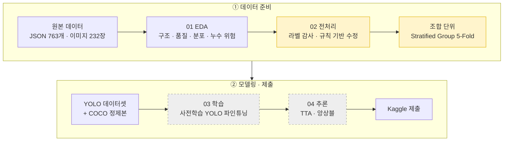

<div align="center">

# 💊 경구약제 이미지 객체 검출

**사진 한 장에서 최대 4개 알약의 종류와 위치를 찾아내는 Object Detection 프로젝트**

<sub>Codeit AI Sprint 15기 · 초급 프로젝트 (개인) · 2026.10.27 – 2026.11.05</sub>

<br>


<br>


</div>

<br>

## 📑 목차
1. [프로젝트 개요](#1-프로젝트-개요)
2. [핵심 성과](#2-핵심-성과)
3. [파이프라인](#3-파이프라인)
4. [데이터 분석 (EDA)](#4-데이터-분석-eda)
5. [데이터 정제](#5-데이터-정제)
6. [검증 전략](#6-검증-전략)
7. [모델링 및 실험](#7-모델링-및-실험)
8. [프로젝트 구조](#8-프로젝트-구조)
9. [실행 방법](#9-실행-방법)
10. [진행 기록](#10-진행-기록)

<br>

## 1. 프로젝트 개요

> 헬스케어 스타트업 **헬스잇(Health Eat)** 의 AI 엔지니어로서, 사용자가 복용 중인 약을 촬영하면
> 어떤 약인지 자동으로 인식하는 모델을 만든다. 이를 통해 **함께 복용하면 안 되는 약 안내** 같은 헬스케어 서비스로 확장할 수 있다.

| 항목 | 내용 |
|:---|:---|
| **과제** | 객체 검출 (Object Detection) – 클래스 + 바운딩 박스 |
| **입력** | 알약 3~4개가 놓인 사진 (976 × 1280) |
| **출력** | 각 알약의 약 종류(56종)와 위치 |
| **데이터** | 학습 232장 (박스 771개) · 테스트 842장 |
| **평가** | Kaggle Private Competition |
| **환경** | Kaggle Notebook (GPU) |

<br>

## 2. 핵심 성과

<table>
<tr>
<td width="33%" align="center">

### 🔍 10건
**라벨 오류 발견·수정**

<sub>범위 밖 박스 1 · 엉뚱한 위치 1 · 누락 8<br>규칙 기반 자동 탐지 + 육안 검수</sub>

</td>
<td width="33%" align="center">

### 🛡️ 0건
**검증 데이터 누수**

<sub>같은 조합의 다른 각도 사진을<br>조합 단위 K-Fold로 분리</sub>

</td>
<td width="33%" align="center">

### 📈 진행 중
**Kaggle 점수**

<sub>베이스라인 → 개선 실험<br>점수 변화와 원인을 함께 기록</sub>

</td>
</tr>
</table>

<br>

## 3. 파이프라인



<sub>노란색: 이 프로젝트의 핵심 설계 · 점선: 진행 예정</sub>

<br>

## 4. 데이터 분석 (EDA)

📓 [`notebooks/01_eda.ipynb`](notebooks/01_eda.ipynb)

### 주요 발견과 의사결정

| 발견 | 근거 | 결정 |
|:---|:---|:---|
| **데이터가 매우 적다** | 학습 232장으로 테스트 842장 예측 | 사전학습 YOLO 파인튜닝 |
| **심한 클래스 불균형** | 최대 157개 vs 최소 3개 (약 50배), 56종 중 29종이 10개 미만 | Copy-Paste 증강, 클래스별 AP 확인 |
| **극소수 클래스** | 17종은 같은 장면을 각도만 바꾼 3장이 전부 | 사실상 1장짜리 클래스 → 증강으로 맥락 다양화 |
| **같은 조합 × 3각도** | 114개 조합, 조합마다 카메라 각도 70°/75°/90° | 이미지 단위 분할은 누수 → **조합 단위 분할** |
| **고정된 배치 위치** | 박스 중심이 몇 개 슬롯에 집중 | 이동·모자이크 증강으로 위치 편향 방지 |
| **Train/Test 분포 차이** | Test가 약간 어둡고(131.5 → 125.9) 대비가 큼 | 밝기·대비·색조 증강 |

<table>
<tr>
<td width="50%"></td>
<td width="50%"></td>
</tr>
<tr>
<td align="center"><sub>클래스별 박스 수 – 롱테일 분포</sub></td>
<td align="center"><sub>같은 조합을 각도만 바꿔 촬영 → 누수 위험</sub></td>
</tr>
</table>

<details>
<summary><b>📊 더 많은 분석 그래프 보기</b></summary>
<br>

| 바운딩 박스 통계 | 클래스별 알약 생김새 |
|:---:|:---:|
|  |  |
| **촬영 조건** | **Train vs Test 이미지 통계** |
|  |  |

</details>

<br>

## 5. 데이터 정제

📓 [`notebooks/02_preprocess.ipynb`](notebooks/02_preprocess.ipynb) · 📄 [`reports/label_fixes.csv`](reports/label_fixes.csv)

라벨을 검증할 **라벨과 독립적인 기준**이 필요했다. 배경이 단색에 가깝다는 EDA 결과를 이용해,
배경 차분(Lab 색 거리 + Otsu 이진화)으로 알약 영역을 분할하고 라벨과 대조했다.

| 오류 유형 | 탐지 규칙 | 수정 | 건수 |
|:---|:---|:---|:---:|
| **범위 밖 박스** | 좌표가 이미지 밖 (x = 6567) | 숫자 하나를 뺀 후보 중 라벨 없는 알약과 가장 잘 맞는 값 → x = 567 | 1 |
| **엉뚱한 위치 박스** | 박스 안이 배경 + 겹치지 않는 같은 크기의 라벨 없는 알약 존재 | 그 알약 위치로 이동 | 1 |
| **누락 박스** | 파일명의 약 코드 중 라벨 없는 것 1개 + 라벨 없는 알약 1개 | 해당 코드로 박스 추가 | 8 |


<p align="center"><sub>위: 원본 라벨 · 아래: 정제 라벨 (노란 박스 = 수정·추가)</sub></p>

> **🔁 실패에서 배운 점** — 처음 만든 "빈 박스 이동" 규칙은 6건을 고쳤지만 **5건이 오탐**이었다.
> 반투명 캡슐과 파란 알약은 분할이 잘 안 돼서 박스가 비어 보였던 것이다.
> "원래 박스와 겹치지 않고 크기가 비슷한 알약"이라는 조건을 더해 진짜 오류 1건만 남겼다.
> **자동 규칙의 결과는 반드시 눈으로 검수한다.**

**최종 무결성 검사 (모두 `assert` 통과)**
- ✅ 모든 이미지에서 파일명의 약 목록 = 라벨의 약 목록
- ✅ 범위 밖 박스 0 · 크기 0 박스 0 · 중복 박스 0
- ✅ YOLO 라벨 → 픽셀 좌표 왕복 변환 오차 < 0.001px

<br>

## 6. 검증 전략

같은 알약 조합을 각도만 바꿔 찍은 사진이 학습과 검증에 나뉘어 들어가면, 모델은 **거의 같은 장면을 다시 맞히는 셈**이 되어 점수가 부풀려진다.

- **Group** = 조합(combo): 한 조합의 모든 사진을 같은 fold에 넣는다
- **Stratify** = 이미지의 가장 희귀한 클래스: 희귀 클래스를 fold에 고르게 분산
- 최종 제출 모델은 232장 **전체**로 학습하고, K-Fold는 실험 비교에 쓴다

| Fold | 검증 이미지 | 검증 조합 | 검증 박스 | 학습에 없는 클래스 |
|:---:|:---:|:---:|:---:|:---:|
| 0 | 47 | 23 | 156 | 5 |
| 1 | 46 | 22 | 153 | 3 |
| 2 | 46 | 23 | 150 | 1 |
| 3 | 46 | 22 | 153 | 7 |
| 4 | 47 | 24 | 159 | 3 |

<sub>"학습에 없는 클래스"는 한 조합에만 등장하는 17종 때문에 생긴다. 새로운 조합에 대한 일반화 성능을 정직하게 재는 설정이다.</sub>

<br>

## 7. 모델링 및 실험

> 🚧 진행 중 – 실험할 때마다 업데이트한다. **한 번에 한 가지만 바꿔** 점수 변화의 원인을 설명할 수 있게 한다.

| # | 날짜 | 변경 사항 | val mAP@50 | val mAP@50-95 | Kaggle | 메모 |
|:---:|:---:|:---|:---:|:---:|:---:|:---|
| 0 | – | 베이스라인 (예정) | – | – | – | |

<br>

## 8. 프로젝트 구조

```
ai-project-01-pill-detection/
├── notebooks/
│   ├── 01_eda.ipynb            # 탐색적 데이터 분석 → 의사결정
│   └── 02_preprocess.ipynb     # 라벨 정제 · YOLO/COCO 변환 · 5-Fold
├── src/                        # 재사용 코드 (학습 · 추론)
├── configs/                    # 학습 설정
├── reports/
│   ├── figures/                # 분석 그래프 (보고서용)
│   ├── label_fixes.csv         # 라벨 수정 내역
│   ├── class_map.csv           # 약 코드 ↔ YOLO 클래스 번호
│   ├── folds.csv               # 이미지별 fold
│   └── annotations_clean.json  # 정제된 COCO 라벨
└── docs/
    ├── PLAN.md                 # 일정표 · 실험 기록
    └── worklog/                # 일별 업무일지
```

<br>

## 9. 실행 방법

<details open>
<summary><b>Kaggle Notebook (권장)</b></summary>

1. Kaggle에서 노트북을 Import 한다 (File → Import Notebook)
2. 오른쪽 패널 **Add Input**에서 대회 데이터를 연결한다. 데이터 경로는 `/kaggle/input`에서 자동으로 찾는다
3. Settings → **Internet On** (한글 폰트 설치용) → **Run All**
4. `01_eda` → `02_preprocess` 순서로 실행한다. 결과물은 `/kaggle/working/`에 저장된다

</details>

<details>
<summary><b>로컬</b></summary>

```bash
pip install -r requirements.txt
```

데이터 폴더를 레포 옆(`../sprint_ai_project1_data`)에 두거나, 환경 변수 `PILL_DATA_DIR`로 경로를 지정한 뒤 노트북을 실행한다.

</details>

> ⚠️ **데이터 사용 규칙** – AI Hub `경구약제조합 5000종`의 `TL_2_조합.zip`, `TS_2_조합.zip`은 대회 데이터의 원본이므로 사용하지 않는다. 원본 데이터는 레포에 포함하지 않는다.

<br>

## 10. 진행 기록

| 문서 | 내용 |
|:---|:---|
| 📅 [일정표](docs/PLAN.md) | 날짜별 할 일 · 마감 · 실험 기록 표 |
| 📝 [업무일지](docs/worklog) | 매일의 작업 · 고민 · 실수와 교훈 |
| 📄 보고서 PDF | 작성 예정 |

<br>

<div align="center">
<sub>Made by <a href="https://github.com/lee-da-gyo">@lee-da-gyo</a> · Codeit AI Sprint 15기</sub>
</div>
