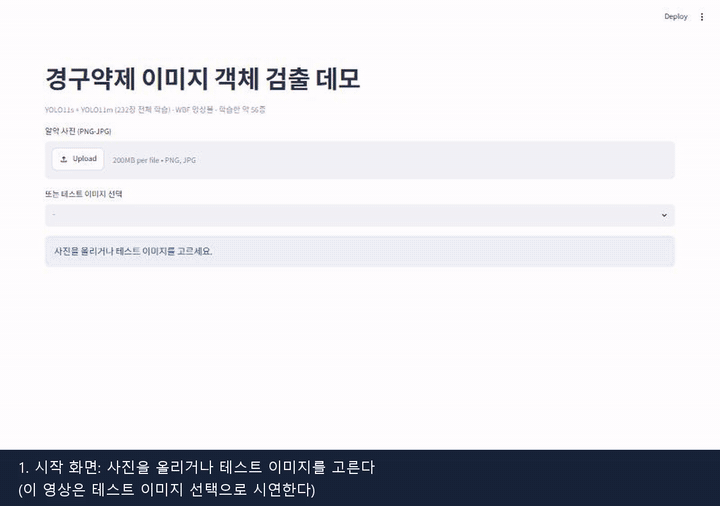
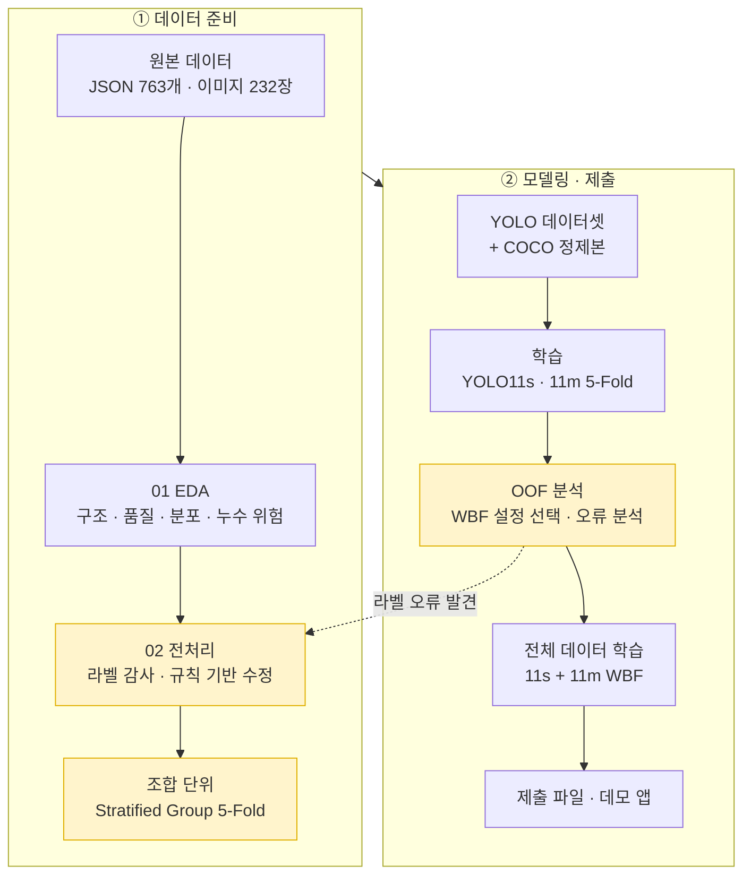
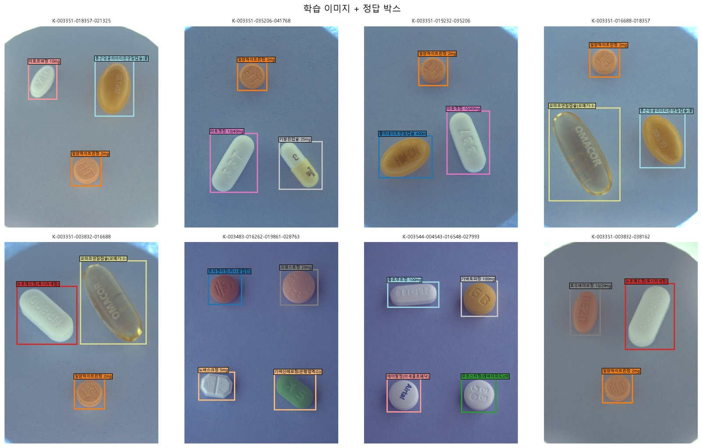
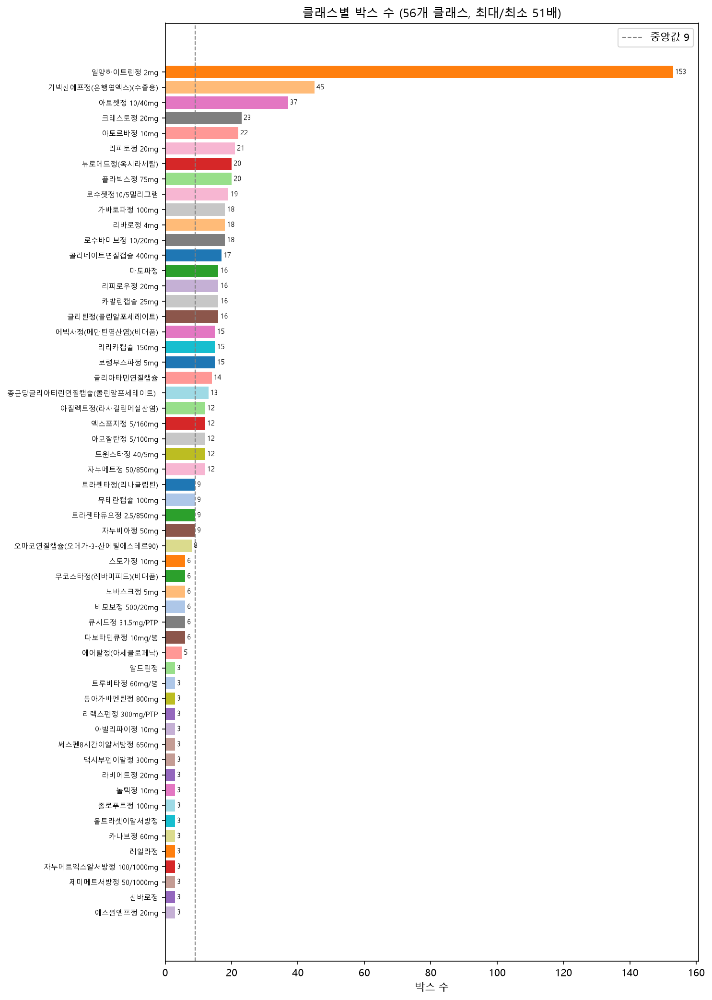
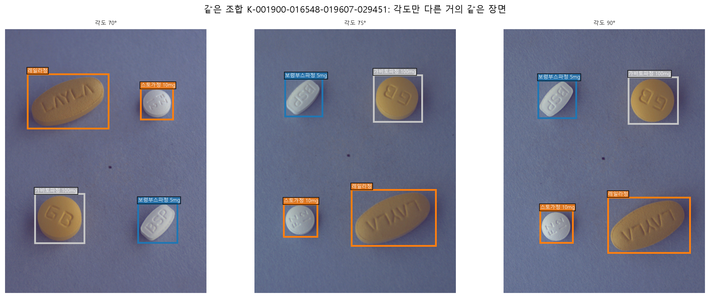
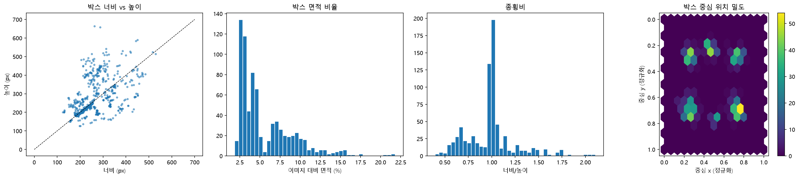
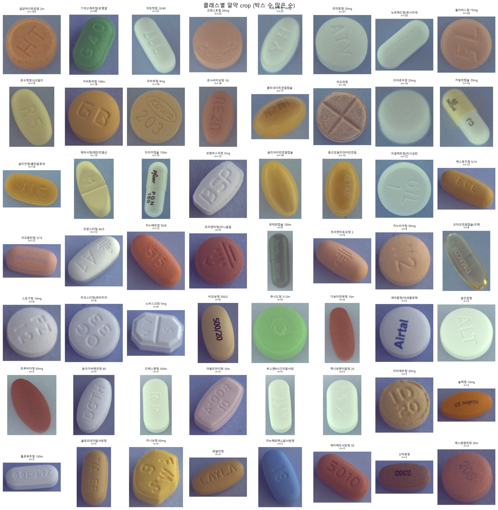
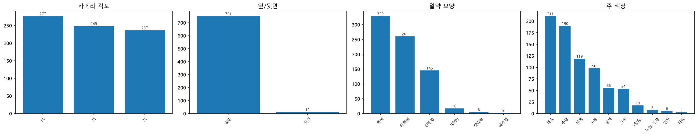
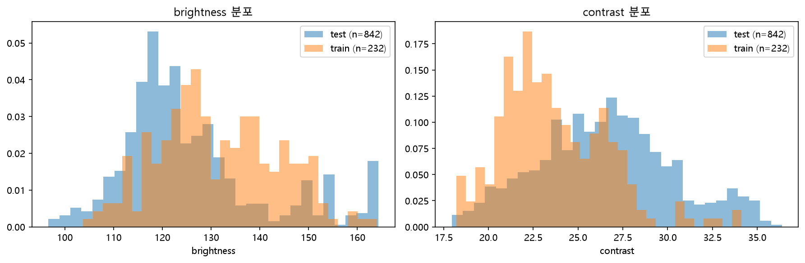
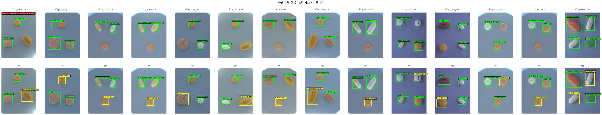

<div align="center">

# 💊 경구약제 이미지 객체 검출

**사진 한 장에서 최대 4개 알약의 종류와 위치를 찾아내는 Object Detection 프로젝트**

<sub>Codeit AI Sprint 15기 · 초급 프로젝트 (개인) · 2026.10.27 – 2026.11.06</sub>

<br>


[](https://github.com/lee-da-gyo/ai-project-01-pill-detection/actions/workflows/ci.yml)


<br>



<sub>데모 앱 시연 (45초 영상을 GIF로 줄임) · 2026.10.27 – 11.06 진행 · 종료</sub>

</div>

<br>

## ⚡ 30초 요약

| | |
|:---|:---|
| **문제** | 알약 3~4개가 놓인 사진에서 56종 약의 이름과 위치를 찾는다. 학습 이미지는 232장뿐이고 29종은 박스가 10개 미만이다 |
| **결과** | **Kaggle public mAP@[0.75:0.95] 0.630** (YOLO11s + 허용 AI Hub 데이터). 대회 데이터만 쓴 YOLO11s + 11m WBF는 0.413 |
| **핵심 기여** | ① 라벨 오류 15건을 찾아 고치고 전체를 다시 학습 ② 같은 약 조합을 같은 fold에 묶어 검증 누수 차단 ③ 두 모델의 박스를 합치는 WBF 앙상블을 직접 구현하고, 합치는 비율은 평가에 쓰지 않은 fold로 골랐다 |
| **배운 점** | 점수 손실의 대부분은 위치가 아니라 **처음 보는 약의 이름**에서 나왔다. 허용된 추가 데이터로 학습한 모델은 대회 데이터만 쓴 모델보다 크게 앞섰다 (0.413 → 0.630). 테스트 정답이 비공개라 원인을 확정하지는 못했다 |
| **바로 보기** | 📄 [보고서 PDF](docs/report/report.pdf) · ▶ [시연 영상 45초](docs/demo/demo.mp4) · ⚙️ [최고 점수 재현 명령](#9-실행-방법) · ✅ [CI 테스트](https://github.com/lee-da-gyo/ai-project-01-pill-detection/actions/workflows/ci.yml) |

<br>

## 📑 목차
1. [프로젝트 개요](#1-프로젝트-개요)
2. [핵심 성과](#2-핵심-성과)
3. [파이프라인](#3-파이프라인)
4. [데이터 분석 (EDA)](#4-데이터-분석-eda)
5. [데이터 정제](#5-데이터-정제)
6. [검증 전략](#6-검증-전략)
7. [모델링 및 실험](#7-모델링-및-실험)
8. [프로젝트 구조](#8-프로젝트-구조)
9. [실행 방법](#9-실행-방법)
10. [진행 기록](#10-진행-기록)

<br>

## 1. 프로젝트 개요

> 헬스케어 스타트업 **헬스잇(Health Eat)** 의 AI 엔지니어로서, 사용자가 복용 중인 약을 촬영하면
> 어떤 약인지 자동으로 인식하는 모델을 만든다. 이를 통해 **함께 복용하면 안 되는 약 안내** 같은 헬스케어 서비스로 확장할 수 있다.

| 항목 | 내용 |
|:---|:---|
| **과제** | 객체 검출 (Object Detection) – 클래스 + 바운딩 박스 |
| **입력** | 알약 3~4개가 놓인 사진 (976 × 1280) |
| **출력** | 각 알약의 약 종류(56종)와 위치 |
| **데이터** | 학습 232장 (박스 771개) · 테스트 842장 |
| **평가** | Kaggle Private Competition |
| **환경** | 로컬 RTX 3060 12GB (학습·실험) · Kaggle Notebook (EDA·전처리 노트북 실행 확인) |

<br>

## 2. 핵심 성과

<table>
<tr>
<td width="33%" align="center">

### 🔍 15건
**라벨 오류 발견·수정 (14장)**

<sub>범위 밖 1 · 엉뚱한 위치 1 · 누락 8 · 같은 좌표 3 · 교환 1장(2박스)<br>자동 탐지 + 다른 각도 사진과 대조한 육안 확인</sub>

</td>
<td width="33%" align="center">

### 🛡️ 114개 조합
**단위로 나눈 5-Fold 검증**

<sub>같은 약 조합을 각도만 바꿔 찍은 사진이<br>학습과 검증에 나뉘지 않게 막아 누수 0건</sub>

</td>
<td width="33%" align="center">

### 🎯 0.630
**Kaggle public mAP@[0.75:0.95]**

<sub>YOLO11s + 허용 AI Hub 조합 데이터<br>대회 데이터만 쓴 모델 0.413 · 11/05 public 상위 4팀 0.611~0.634</sub>

</td>
</tr>
</table>

<br>

## 3. 파이프라인



<sub>노란색: 이 프로젝트의 핵심 설계 · 점선: 오류 분석에서 찾은 라벨 오류를 정제 단계로 되돌려 고치고 전체를 다시 학습했다</sub>

<br>

## 4. 데이터 분석 (EDA)

📓 [`notebooks/01_eda.ipynb`](notebooks/01_eda.ipynb)

<p align="center"><br><sub>학습 이미지와 정답 박스: 단색 배경에 알약 3~4개, 고정된 카메라</sub></p>

### 주요 발견과 의사결정

| 발견 | 근거 | 결정 |
|:---|:---|:---|
| **데이터가 매우 적다** | 학습 232장으로 테스트 842장 예측 | 사전학습 YOLO 파인튜닝 |
| **심한 클래스 불균형** | 최대 157개 vs 최소 3개 (약 50배), 56종 중 29종이 10개 미만 | Copy-Paste 증강, 클래스별 AP 확인 |
| **극소수 클래스** | 17종은 같은 장면을 각도만 바꾼 3장이 전부 | 사실상 1장짜리 클래스 → 증강으로 맥락 다양화 |
| **같은 조합을 여러 각도로** | 114개 조합을 최대 세 각도(70°/75°/90°)로 촬영. 실제로는 조합당 1~3장 (3장 40 · 2장 38 · 1장 36조합) | 이미지 단위 분할은 누수 → **조합 단위 분할** |
| **고정된 배치 위치** | 박스 중심이 몇 개 슬롯에 집중 | 이동·모자이크 증강으로 위치 편향 방지 |
| **Train/Test 분포 차이** | Test가 약간 어둡고(131.5 → 125.9) 대비가 큼 | 밝기·대비·색조 증강 |

<table>
<tr>
<td width="50%"></td>
<td width="50%"></td>
</tr>
<tr>
<td align="center"><sub>클래스별 박스 수 – 롱테일 분포</sub></td>
<td align="center"><sub>같은 조합을 각도만 바꿔 촬영 → 누수 위험</sub></td>
</tr>
</table>

<details>
<summary><b>📊 더 많은 분석 그래프 보기</b></summary>
<br>

| 바운딩 박스 통계 | 클래스별 알약 생김새 |
|:---:|:---:|
|  |  |
| **촬영 조건** | **Train vs Test 이미지 통계** |
|  |  |

</details>

<br>

## 5. 데이터 정제

📓 [`notebooks/02_preprocess.ipynb`](notebooks/02_preprocess.ipynb) · 📄 [`reports/label_fixes.csv`](reports/label_fixes.csv) · ✅ [검수 기록](docs/LABEL_REVIEW.md)

라벨을 검증할 **라벨과 독립적인 기준**이 필요했다. 배경이 단색에 가깝다는 EDA 결과를 이용해,
배경 차분(Lab 색 거리 + Otsu 이진화)으로 알약 영역을 분할하고 라벨과 대조했다.

| 오류 유형 | 탐지 규칙 | 수정 | 건수 |
|:---|:---|:---|:---:|
| **범위 밖 박스** | 좌표가 이미지 밖 (x = 6567) | 숫자 하나를 뺀 후보 중 라벨 없는 알약과 가장 잘 맞는 값 → x = 567 | 1 |
| **엉뚱한 위치 박스** | 박스 안이 배경 + 겹치지 않는 같은 크기의 라벨 없는 알약 존재 | 그 알약 위치로 이동 | 1 |
| **누락 박스** | 파일명의 약 코드 중 라벨 없는 것 1개 + 라벨 없는 알약 1개 | 해당 코드로 박스 추가 | 8 |
| **다른 약끼리 같은 좌표** * | 한 이미지에서 다른 약 박스 쌍의 IoU ≥ 0.9 (후보만 자동 탐지) | 다른 각도 사진으로 확인한 틀린 라벨을 라벨 없는 알약으로 이동 | 3 |
| **라벨 교환** * | OOF 예측이 정답과 신뢰도 0.9 이상으로 다르게 답함 (모델 보조 사후 감사) | 다른 각도 사진으로 확인한 두 박스의 약 코드 교환 | 1장 (2박스) |

<sub>* 오류 분석 뒤에 추가한 감사. 앞의 네 유형은 모델 예측을 쓰지 않는 데이터 내부 감사이고, 라벨 교환은 모델 예측으로 후보를 만든 비독립 감사다.
후보는 자동으로 고치지 않고, 사람이 확인한 결정([`configs/label_review.csv`](configs/label_review.csv): 검수자 · 검수일 · 검수 때 본 두 박스 좌표)만 파이프라인이 적용한다. 현재 라벨이 그 좌표와 같을 때만 적용하므로 다시 실행해도 결과가 같다. 후보 전체와 확인 결과: [`label_audit_candidates.csv`](reports/label_audit_candidates.csv)</sub>


<p align="center"><sub>위: 원본 라벨 · 아래: 정제 라벨 (노란 박스 = 수정·추가)</sub></p>

> **🔁 실패에서 배운 점** — 처음 만든 "빈 박스 이동" 규칙은 6건을 고쳤지만 **5건이 오탐**이었다.
> 반투명 캡슐과 파란 알약은 분할이 잘 안 돼서 박스가 비어 보였던 것이다.
> "원래 박스와 겹치지 않고 크기가 비슷한 알약"이라는 조건을 더해 진짜 오류 1건만 남겼다.
> **자동 규칙의 결과는 반드시 눈으로 검수한다.**

> **🔁 처음 정제가 놓친 오류** — 처음 무결성 검사는 "같은 약 박스의 중복"만 확인해, **서로 다른 약 두 개가 같은 좌표에 라벨된 경우**를 통과시켰다.
> 오류 분석에서 "학습한 약을 신뢰도 0.98로 틀렸다"고 나온 사례를 원본과 대조하다가, 실제로는 **모델이 맞고 라벨이 틀린 4장**을 찾았다.
> 4장을 고친 뒤 5-Fold와 최종 모델을 **모두 다시 학습**했다. 아래 모든 5-Fold·OOF·제출 수치는 수정된 라벨 기준이다 (수정 전 기록은 Git 이력 `a0ef2ce` 이전).

**최종 무결성 검사 (모두 `assert` 통과)**
- ✅ 모든 이미지에서 파일명의 약 목록 = 라벨의 약 목록
- ✅ 범위 밖 박스 0 · 크기 0 박스 0 · 같은 약 중복 0 · 결정이 없는 다른 약끼리 같은 좌표(IoU ≥ 0.9) 0
- ✅ YOLO 라벨 → 픽셀 좌표 왕복 변환 오차 < 0.001px

<br>

## 6. 검증 전략

같은 알약 조합을 각도만 바꿔 찍은 사진이 학습과 검증에 나뉘어 들어가면, 모델은 **거의 같은 장면을 다시 맞히는 셈**이 되어 점수가 부풀려진다. 아래 설계로 **같은 조합에 의한 누수**를 막는다.

- **Group** = 조합(combo): 한 조합의 모든 사진을 같은 fold에 넣는다
- **Stratify** = 이미지의 가장 희귀한 클래스: 희귀 클래스를 fold에 고르게 분산
- 최종 제출 모델은 232장 **전체**로 학습하고, K-Fold는 실험 비교에 쓴다

| Fold | 검증 이미지 | 검증 조합 | 검증 박스 | 학습에 없는 클래스 |
|:---:|:---:|:---:|:---:|:---:|
| 0 | 47 | 23 | 156 | 5 |
| 1 | 46 | 22 | 153 | 3 |
| 2 | 46 | 23 | 150 | 1 |
| 3 | 46 | 22 | 153 | 7 |
| 4 | 47 | 24 | 159 | 3 |

<sub>"학습에 없는 클래스"는 한 fold에만 있는 19종 때문에 생긴다 (17종은 조합 하나에만 나오고, 2종은 여러 조합에 나오지만 모두 같은 fold에 들어갔다). 새로운 조합에 대한 일반화 성능을 정직하게 재는 설정이다.</sub>

> **한계와 대응** – 층화 기준이 "이미지의 가장 희귀한 클래스 하나"라서 다중 라벨을 완전히 반영하지 못하고, fold마다 처음 보는 클래스 수가 1~7개로 다르다.
> 이미 진행한 실험과의 비교를 유지하려고 분할은 바꾸지 않았다. 대신 fold 하나의 결과로 결론 내리지 않고, 최종 후보는 **5-Fold 평균·표준편차**로 판단한다.
> 전체 데이터로 학습하는 최종 모델은 검증 데이터가 학습에 포함되므로 검증 점수로 고르지 않고, 교차검증으로 정한 **고정 에포크**로 학습해 마지막 가중치를 쓴다.

<br>

## 7. 모델링 및 실험

📓 [`notebooks/03_baseline.ipynb`](notebooks/03_baseline.ipynb) · 📄 [`reports/experiments.csv`](reports/experiments.csv) · ⚙️ [`configs/`](configs) · 🔬 **[실험 기록 전체 (표 · 그림 · 통계 검정)](docs/EXPERIMENTS.md)**

> **한 번에 한 가지만 바꿔** 점수 변화의 원인을 설명할 수 있게 한다. 실험 하나 = 설정 파일 하나이고,
> `python scripts/run_experiment.py --config configs/<실험>.yaml` 한 줄로 학습 → 평가 → 제출 파일 → 기록까지 실행된다.
> 채택 여부를 가르는 기준은 실행 전에 설정 파일에 적어 두었다 (예: fold 0에서 +0.005 이상일 때만 5-Fold로 확인).

### 결정 요약

| 질문 | 비교 방법 | 결과 (mAP50-95, 37종 OOF는 조건부 진단값) | 결정 |
|:---|:---|:---|:---|
| 모델 크기 · 구조 | fold 0, YOLO11n · s · m · YOLO26s | 11m 0.839 · 11s 0.835 · 11n 0.823 · 26s 0.810 | 11s · 11m을 5-Fold로 다시 비교 |
| 단일 모델 vs 앙상블 | 5-Fold OOF (37종) | 11s 0.956 · 11m 0.941 · **WBF 0.964** | **WBF 2:1, IoU 0.6** (근사 메타 검증 5번 모두 2:1) |
| 입력 해상도 | fold 0, 640 · 960 · 1280px | 0.835 · 0.811 · 0.830 | 640 유지 |
| 색 보정 (CLAHE) | 5-Fold + 조합 부트스트랩 | fold 2개 상승 · 3개 하락, OOF +0.006 (부트스트랩 중앙값 +0.005, 95% 구간 −0.003 ~ +0.018) | 미채택 |
| TTA | 5-Fold OOF 짝 비교 | 11s −0.004 · 11m −0.005 | 미채택 |
| Copy-Paste 합성 400장 | fold 0 | −0.012 | 이 설정만 기각 |
| 2단계 (검출 + 분류기) | fold 0, 분류기 3종 5-Fold 비교 후 | −0.002 | 미채택 (분류기는 EfficientNet-B0이 F1 0.994로 최고) |
| 학습률 3배 · 0.3배 | fold 0 | +0.0025 · −0.0087 | auto 유지 (사전 기준 +0.005 미달) |
| **허용 추가 데이터 (AI Hub)** | Kaggle public, YOLO11s 단일 | 0.40954 → **0.63017** | **최고 점수 제출** ↓ |

<sub>fold 0 탐색 일부는 라벨 오류 4장을 고치기 전 기록이라 라벨 수정 뒤 5-Fold 결과와 직접 비교하지 않는다. 자세한 조건과 그림은 [실험 기록 전체](docs/EXPERIMENTS.md).</sub>

### 대표 점수 0.630: 허용 추가 데이터(AI Hub) 학습

Kaggle 점수(0.413)가 내부 진단값보다 크게 낮았고, 대회 안내를 다시 읽어 **허용된 외부 데이터**(AI Hub `경구약제조합 5000종`)를 추가로 학습했다.
금지 파일 `TL_2_조합.zip` · `TS_2_조합.zip`은 열지 않고 건너뛴다 ([`prepare_aihub.py`](scripts/prepare_aihub.py), [로그](reports/logs/prepare_aihub.log)).

| 단계 | 내용 |
|:---|:---|
| 정제 | 라벨 · 이미지 7묶음에서 형식이 틀린 박스, 약 코드와 박스가 맞지 않는 이미지, 테스트와 거의 같은 이미지(중복 확정 36장과 그 조합의 66장)를 뺐다 → **10,175장 · 박스 39,198개 · 약 116종** (대회 56종 중 54종 포함, 새 약 62종 → 118클래스) |
| 에포크 결정 | [`a1`](configs/a1_aihub_yolo11s.yaml): AI Hub 90% + 대회 fold 0 밖으로 학습, 대회 fold 0 + AI Hub 10% 조합으로 검증 → best epoch **28** (학습 전에 정한 규칙) |
| 제출 모델 | [`a2`](configs/a2_aihub_full_yolo11s.yaml): 대회 232장 + AI Hub 전체로 28 에포크, 검증 없이 `last.pt` |

| Kaggle 제출 | 학습 데이터 | 모델 | public mAP@[0.75:0.95] |
|:---|:---|:---|:---:|
| 대회 데이터만 | 232장 | YOLO11s | 0.40954 |
| 대회 데이터만 (주력) | 232장 | YOLO11s + 11m WBF | 0.41349 |
| 시험 학습 | + AI Hub 1묶음, 15 에포크 | YOLO11s | 0.52212 |
| **최종** | **+ AI Hub 7묶음 (10,175장)** | **YOLO11s** | **0.63017** |

<sub>참고: 11/05 리더보드에서 public 상위 4팀은 0.611 ~ 0.634였다. private 점수와 최종 순위는 이 저장소에 기록하지 않았다. 같은 방식의 YOLO11m과 WBF 제출 파일도 만들었으나 11/06 업무일지 기준으로 제출하지 않았다.</sub>

**이 비교의 한계**
- 데이터 양, 클래스 수(56 → 118), 에포크가 함께 바뀌어 **추가 데이터 하나의 효과로 나눌 수 없다**.
- 테스트와의 중복 검사는 128px 축소본 평균 차이 1.0 미만인 **거의 같은 이미지만** 거른다 (테스트와의 최소 거리 1% 분위수 1.27).
  대회 학습 데이터에서 막았던 "같은 조합을 다른 각도로 찍은 사진"은 테스트의 조합 정보가 없어 확인할 수 없다. 그래서 점수 상승의 일부가 이런 겹침에서 왔을 가능성을 배제하지 못한다.

### 검증 설계의 한계

- **fold 점수는 조금 낙관적이다.** 각 fold는 같은 검증 fold로 조기 종료(patience 30)하고 `best.pt`를 골라 평가했다. 모든 후보가 같은 방식이라 **후보 사이의 비교**에는 쓸 수 있지만, 절댓값은 실제보다 높게 나올 수 있다. 제출 모델은 고정 에포크의 `last.pt`라 이 선택의 영향을 받지 않는다.
- **학습 시드는 하나(42)다.** 조합 부트스트랩은 평가 표본의 흔들림만 반영하고 학습 무작위성은 재지 않았다. 그래서 0.005 미만의 차이는 결론에 쓰지 않았다.
- **판정 근거가 실험마다 완전히 같지는 않다.** CLAHE · TTA 기각은 37종 통합 OOF, 조합 부트스트랩 구간, fold별 방향을 함께 보았다. WBF 채택은 통합 OOF와 근사 메타 검증으로 판단했다.
- 표의 "부트스트랩 개선 비율"은 조합 단위 재표본 1,000회 중 차이가 0보다 큰 비율이다. 개선될 확률(사후확률)이 아니다.
- 희귀 19종의 성능은 잴 수 없다. 이 중 17종은 조합 하나에만 나오고, 2종은 여러 조합에 나오지만 모두 같은 fold에 들어갔다. 어느 쪽이든 검증될 때 학습 데이터에 없다.

### 데모 앱

```bash
streamlit run app/demo.py
```

사진을 올리면 알약마다 위치 · 약 이름 · 영문명 · 신뢰도 · 다른 후보를 보여 준다. 신뢰도가 0.5 미만이거나 같은 알약에 이름이 두 개 이상 붙으면 **"확인 필요"**로 표시한다.
위의 분석처럼 처음 보는 약은 높은 신뢰도로도 틀릴 수 있어, 이 표시가 오답을 모두 거르지는 못한다는 경고를 함께 띄운다. 

<sub>데모는 대회 데이터만으로 학습한 YOLO11s + 11m WBF(56종)를 쓴다. 0.630 모델은 클래스 체계가 118종으로 달라 앱의 약 정보와 맞추지 않았다. 학습한 가중치(`runs/`)는 용량 때문에 저장소에 없으므로, 앱을 실행하려면 [9. 실행 방법](#9-실행-방법)의 최종 모델 학습을 먼저 해야 한다.</sub>

▶ [시연 영상 (docs/demo/demo.mp4, 45초)](docs/demo/demo.mp4): 실행 화면을 캡처해 자막과 함께 엮었다. 음성은 없고, 테스트 이미지 선택으로 시연했으며 파일 업로드 화면은 보여 주지 않는다.

<br>

## 8. 프로젝트 구조

| 폴더 | 내용 |
|:---|:---|
| [`src/pilldet/`](src/pilldet) | 공통 코드 17개 모듈: 라벨 감사 · 정제, 조합 단위 분할, COCO mAP 평가, WBF, 제출 파일 |
| [`scripts/`](scripts) | 데이터 준비 → 실험 → 5-Fold 분석 → 제출을 명령 한 줄씩으로 실행 |
| [`app/demo.py`](app/demo.py) | Streamlit 데모 앱 |
| [`tests/`](tests) | 단위 테스트 50개, push마다 [CI](.github/workflows/ci.yml)에서 실행 |
| `notebooks/` · `configs/` · `reports/` · `docs/` | 분석 과정 · 실험 설정(실험 하나 = 파일 하나) · 결과와 로그 · 보고서와 업무일지 |

**설계 원칙**: 로직은 `src/pilldet`에 한 번만 구현하고, 노트북은 그것을 불러 **과정과 결과를 설명**하며, 스크립트는 같은 로직을 **자동으로 실행**한다. 그래서 노트북과 스크립트의 결과가 항상 같다.
전체 파일 트리는 [실행 방법과 전체 구조](docs/REPRODUCE.md#프로젝트-구조)에 있다.

<br>

## 9. 실행 방법

```bash
pip install -r requirements.txt
python scripts/prepare_data.py      # 라벨 정제 · YOLO/COCO 변환 · 5-Fold (약 15초)
python -m pytest tests              # 단위 테스트 (데이터 없이 실행)

# ★ Kaggle 최고 점수 모델 (public 0.63017): 허용 AI Hub 조합 데이터를 받아 둔 뒤
python scripts/prepare_aihub.py --labels <라벨 zip 폴더> --images <이미지 zip 폴더>
python scripts/train_aihub.py --config configs/a2_aihub_full_yolo11s.yaml    # 28 에포크 (a1 검증 학습으로 정한 값)
python scripts/make_submission.py --runs a2_aihub_full_yolo11s --name a2_aihub_full_11s --class-map class_map_aihub.csv
```

모든 실험 · 5-Fold 분석 · 보고서 빌드 명령, 데이터 폴더 지정, Kaggle Notebook 실행 방법, 재현 조건은 [실행 방법과 전체 구조](docs/REPRODUCE.md#실행-방법)에 있다.

> ⚠️ **데이터 사용 규칙** – AI Hub `경구약제조합 5000종`의 `TL_2_조합.zip`, `TS_2_조합.zip`은 대회 안내상 금지 파일이므로 사용하지 않는다 (`scripts/prepare_aihub.py`는 이 이름을 열지 않고 건너뛴다). 그 밖의 허용 데이터로 하는 후속 실험의 산출물은 저장소에 넣지 않는다. 원본 데이터는 레포에 포함하지 않는다.

<br>

## 10. 진행 기록

| 문서 | 내용 |
|:---|:---|
| 📅 [일정표](docs/PLAN.md) | 날짜별 할 일 · 마감 · 실험 기록 표 |
| 📝 [업무일지 PDF](docs/worklog/worklog.pdf) · [원본](docs/worklog) | 매일의 작업 · 고민 · 실수와 교훈 |
| 📄 [보고서 PDF](docs/report/report.pdf) | 문제 정의 → EDA → 정제 → 검증 → 실험 → 결과 분석 → 시사점 (내려받기) |
| ✅ [라벨 검수 기록](docs/LABEL_REVIEW.md) | 라벨 수정 15건의 근거 |

<br>

## 라이선스

코드는 [MIT License](LICENSE)를 따른다. 대회 원본 이미지와 AI Hub 데이터는 저장소에 넣지 않았다. 다만 분석 결과를 보여 주려고 정제한 대회 라벨([`reports/annotations_clean.json`](reports/annotations_clean.json))과 대회 이미지를 그린 그림(`reports/figures/`, `reports/experiments/*/val_batch*.jpg`)은 포함했다. 이 데이터와 그림은 MIT License 대상이 아니며 대회 · AI Hub의 이용 조건을 따른다.

<br>

<div align="center">
<sub>Made by <a href="https://github.com/lee-da-gyo">@lee-da-gyo</a> · Codeit AI Sprint 15기</sub>
</div>
