<div align="center">

# 💊 경구약제 이미지 객체 검출

**사진 한 장에서 최대 4개 알약의 종류와 위치를 찾아내는 Object Detection 프로젝트**

<sub>Codeit AI Sprint 15기 · 초급 프로젝트 (개인) · 2026.10.27 – 2026.11.05</sub>

<br>


<br>

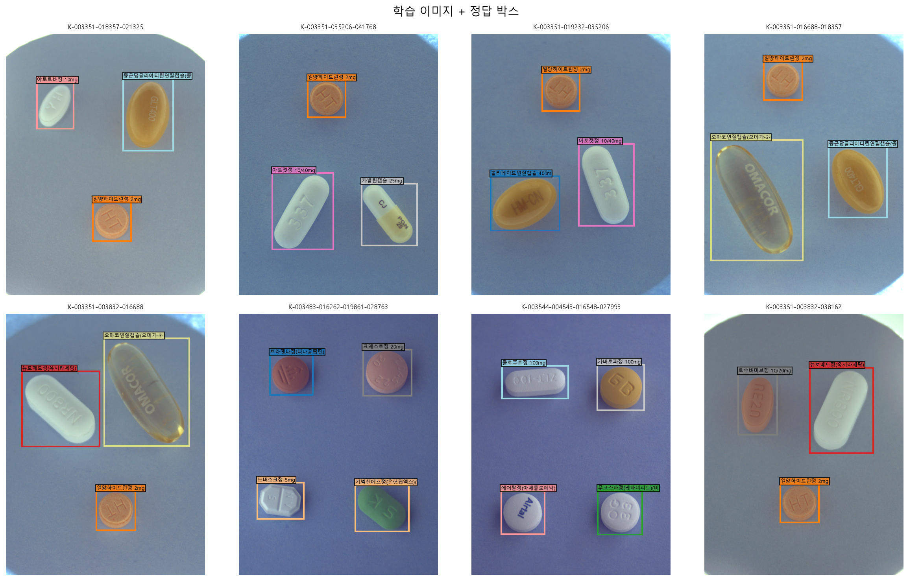

</div>

<br>

## 📑 목차
1. [프로젝트 개요](#1-프로젝트-개요)
2. [핵심 성과](#2-핵심-성과)
3. [파이프라인](#3-파이프라인)
4. [데이터 분석 (EDA)](#4-데이터-분석-eda)
5. [데이터 정제](#5-데이터-정제)
6. [검증 전략](#6-검증-전략)
7. [모델링 및 실험](#7-모델링-및-실험)
8. [프로젝트 구조](#8-프로젝트-구조)
9. [실행 방법](#9-실행-방법)
10. [진행 기록](#10-진행-기록)

<br>

## 1. 프로젝트 개요

> 헬스케어 스타트업 **헬스잇(Health Eat)** 의 AI 엔지니어로서, 사용자가 복용 중인 약을 촬영하면
> 어떤 약인지 자동으로 인식하는 모델을 만든다. 이를 통해 **함께 복용하면 안 되는 약 안내** 같은 헬스케어 서비스로 확장할 수 있다.

| 항목 | 내용 |
|:---|:---|
| **과제** | 객체 검출 (Object Detection) – 클래스 + 바운딩 박스 |
| **입력** | 알약 3~4개가 놓인 사진 (976 × 1280) |
| **출력** | 각 알약의 약 종류(56종)와 위치 |
| **데이터** | 학습 232장 (박스 771개) · 테스트 842장 |
| **평가** | Kaggle Private Competition |
| **환경** | Kaggle Notebook (GPU) |

<br>

## 2. 핵심 성과

<table>
<tr>
<td width="33%" align="center">

### 🔍 10건
**라벨 오류 발견·수정**

<sub>범위 밖 박스 1 · 엉뚱한 위치 1 · 누락 8<br>규칙 기반 자동 탐지 + 육안 검수</sub>

</td>
<td width="33%" align="center">

### 🛡️ 0건
**같은 조합의 검증 누수**

<sub>같은 조합의 다른 각도 사진을<br>조합 단위 K-Fold로 분리</sub>

</td>
<td width="33%" align="center">

### 🎯 0.835
**베이스라인 검증 mAP50-95**

<sub>YOLO11s · 조합 단위 fold 0<br>Kaggle 점수는 제출 후 기록</sub>

</td>
</tr>
</table>

<br>

## 3. 파이프라인

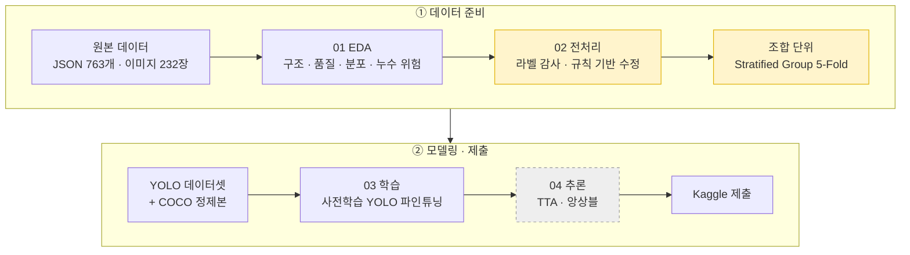

<sub>노란색: 이 프로젝트의 핵심 설계 · 점선: 진행 예정</sub>

<br>

## 4. 데이터 분석 (EDA)

📓 [`notebooks/01_eda.ipynb`](notebooks/01_eda.ipynb)

### 주요 발견과 의사결정

| 발견 | 근거 | 결정 |
|:---|:---|:---|
| **데이터가 매우 적다** | 학습 232장으로 테스트 842장 예측 | 사전학습 YOLO 파인튜닝 |
| **심한 클래스 불균형** | 최대 157개 vs 최소 3개 (약 50배), 56종 중 29종이 10개 미만 | Copy-Paste 증강, 클래스별 AP 확인 |
| **극소수 클래스** | 17종은 같은 장면을 각도만 바꾼 3장이 전부 | 사실상 1장짜리 클래스 → 증강으로 맥락 다양화 |
| **같은 조합 × 3각도** | 114개 조합, 조합마다 카메라 각도 70°/75°/90° | 이미지 단위 분할은 누수 → **조합 단위 분할** |
| **고정된 배치 위치** | 박스 중심이 몇 개 슬롯에 집중 | 이동·모자이크 증강으로 위치 편향 방지 |
| **Train/Test 분포 차이** | Test가 약간 어둡고(131.5 → 125.9) 대비가 큼 | 밝기·대비·색조 증강 |

<table>
<tr>
<td width="50%">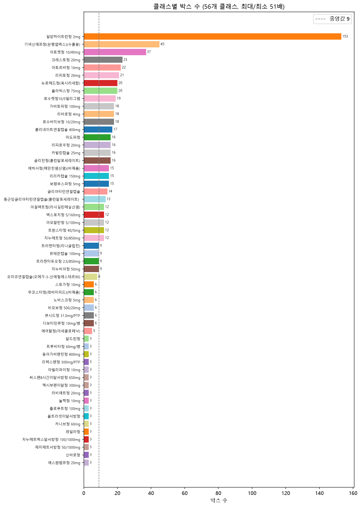</td>
<td width="50%">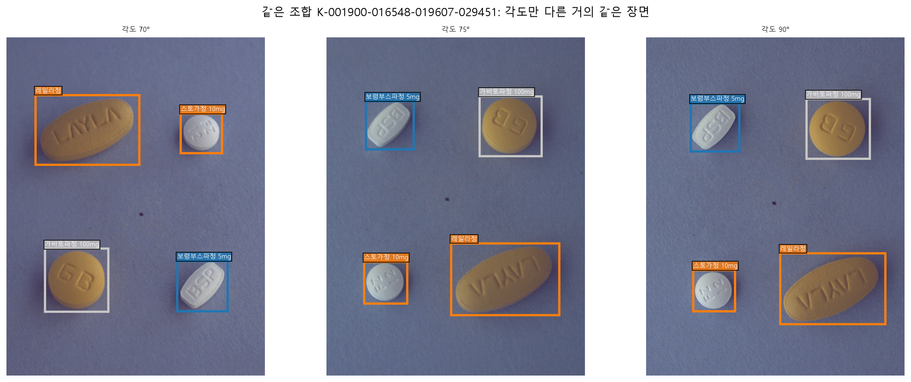</td>
</tr>
<tr>
<td align="center"><sub>클래스별 박스 수 – 롱테일 분포</sub></td>
<td align="center"><sub>같은 조합을 각도만 바꿔 촬영 → 누수 위험</sub></td>
</tr>
</table>

<details>
<summary><b>📊 더 많은 분석 그래프 보기</b></summary>
<br>

| 바운딩 박스 통계 | 클래스별 알약 생김새 |
|:---:|:---:|
| 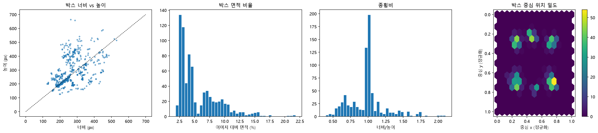 | 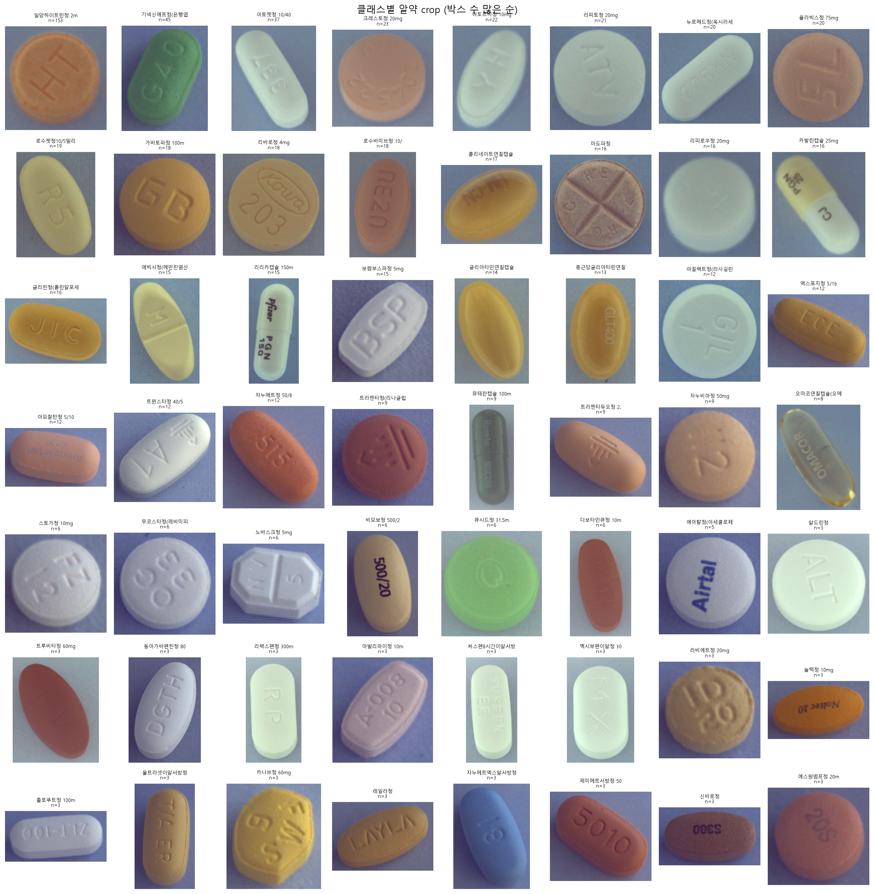 |
| **촬영 조건** | **Train vs Test 이미지 통계** |
| 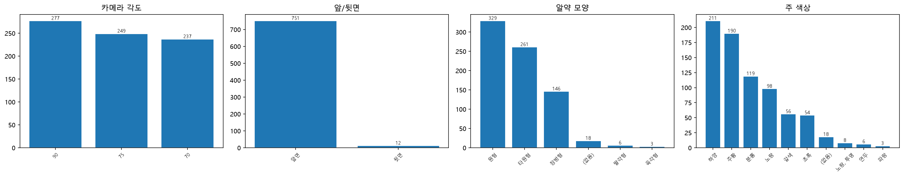 | 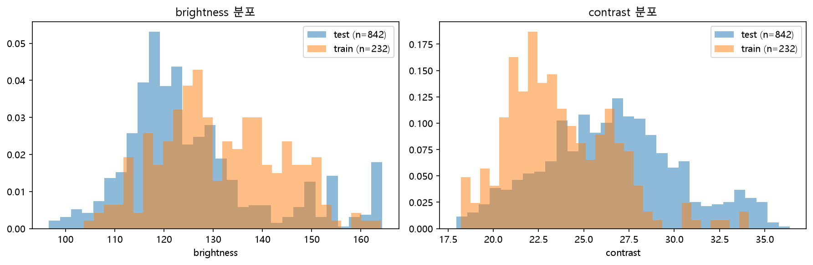 |

</details>

<br>

## 5. 데이터 정제

📓 [`notebooks/02_preprocess.ipynb`](notebooks/02_preprocess.ipynb) · 📄 [`reports/label_fixes.csv`](reports/label_fixes.csv) · ✅ [검수 기록](docs/LABEL_REVIEW.md)

라벨을 검증할 **라벨과 독립적인 기준**이 필요했다. 배경이 단색에 가깝다는 EDA 결과를 이용해,
배경 차분(Lab 색 거리 + Otsu 이진화)으로 알약 영역을 분할하고 라벨과 대조했다.

| 오류 유형 | 탐지 규칙 | 수정 | 건수 |
|:---|:---|:---|:---:|
| **범위 밖 박스** | 좌표가 이미지 밖 (x = 6567) | 숫자 하나를 뺀 후보 중 라벨 없는 알약과 가장 잘 맞는 값 → x = 567 | 1 |
| **엉뚱한 위치 박스** | 박스 안이 배경 + 겹치지 않는 같은 크기의 라벨 없는 알약 존재 | 그 알약 위치로 이동 | 1 |
| **누락 박스** | 파일명의 약 코드 중 라벨 없는 것 1개 + 라벨 없는 알약 1개 | 해당 코드로 박스 추가 | 8 |

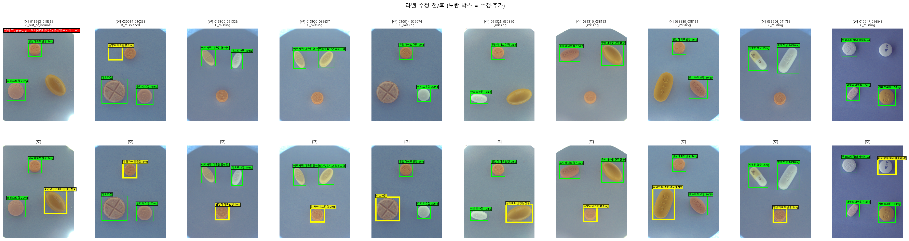
<p align="center"><sub>위: 원본 라벨 · 아래: 정제 라벨 (노란 박스 = 수정·추가)</sub></p>

> **🔁 실패에서 배운 점** — 처음 만든 "빈 박스 이동" 규칙은 6건을 고쳤지만 **5건이 오탐**이었다.
> 반투명 캡슐과 파란 알약은 분할이 잘 안 돼서 박스가 비어 보였던 것이다.
> "원래 박스와 겹치지 않고 크기가 비슷한 알약"이라는 조건을 더해 진짜 오류 1건만 남겼다.
> **자동 규칙의 결과는 반드시 눈으로 검수한다.**

**최종 무결성 검사 (모두 `assert` 통과)**
- ✅ 모든 이미지에서 파일명의 약 목록 = 라벨의 약 목록
- ✅ 범위 밖 박스 0 · 크기 0 박스 0 · 중복 박스 0
- ✅ YOLO 라벨 → 픽셀 좌표 왕복 변환 오차 < 0.001px

<br>

## 6. 검증 전략

같은 알약 조합을 각도만 바꿔 찍은 사진이 학습과 검증에 나뉘어 들어가면, 모델은 **거의 같은 장면을 다시 맞히는 셈**이 되어 점수가 부풀려진다. 아래 설계로 **같은 조합에 의한 누수**를 막는다.

- **Group** = 조합(combo): 한 조합의 모든 사진을 같은 fold에 넣는다
- **Stratify** = 이미지의 가장 희귀한 클래스: 희귀 클래스를 fold에 고르게 분산
- 최종 제출 모델은 232장 **전체**로 학습하고, K-Fold는 실험 비교에 쓴다

| Fold | 검증 이미지 | 검증 조합 | 검증 박스 | 학습에 없는 클래스 |
|:---:|:---:|:---:|:---:|:---:|
| 0 | 47 | 23 | 156 | 5 |
| 1 | 46 | 22 | 153 | 3 |
| 2 | 46 | 23 | 150 | 1 |
| 3 | 46 | 22 | 153 | 7 |
| 4 | 47 | 24 | 159 | 3 |

<sub>"학습에 없는 클래스"는 한 조합에만 등장하는 17종 때문에 생긴다. 새로운 조합에 대한 일반화 성능을 정직하게 재는 설정이다.</sub>

> **한계와 대응** – 층화 기준이 "이미지의 가장 희귀한 클래스 하나"라서 다중 라벨을 완전히 반영하지 못하고, fold마다 처음 보는 클래스 수가 1~7개로 다르다.
> 이미 진행한 실험과의 비교를 유지하려고 분할은 바꾸지 않았다. 대신 fold 하나의 결과로 결론 내리지 않고, 최종 후보는 **5-Fold 평균·표준편차**로 판단한다.
> 전체 데이터로 학습하는 최종 모델은 검증 데이터가 학습에 포함되므로 검증 점수로 고르지 않고, 교차검증으로 정한 **고정 에포크**로 학습해 마지막 가중치를 쓴다.

<br>

## 7. 모델링 및 실험

📓 [`notebooks/03_baseline.ipynb`](notebooks/03_baseline.ipynb) · 📄 [`reports/experiments.csv`](reports/experiments.csv) · ⚙️ [`configs/`](configs)

> 🚧 진행 중 – 실험할 때마다 업데이트한다. **한 번에 한 가지만 바꿔** 점수 변화의 원인을 설명할 수 있게 한다.
> 실험 하나 = 설정 파일 하나. `python scripts/run_experiment.py --config configs/<실험>.yaml` 한 줄로 학습 → 평가 → 제출 파일 → 기록까지 실행된다.

| ID | 변경 사항 | val mAP50 | **val mAP50-95** | (보조) 학습한 약만 | Kaggle | 학습 시간 |
|:---:|:---|:---:|:---:|:---:|:---:|:---:|
| E0 | 베이스라인: YOLO11s · 640px · 기본 증강 | 0.847 | 0.835 | 0.985 | – | 5.7분 |
| E1 | 해상도 960px | 0.824 | 0.811 | 0.955 | – | 11.6분 |
| E1 | 해상도 1280px | 0.837 | 0.830 | 0.978 | – | 41.3분 |
| E2 | 모델 크기 YOLO11n | 0.842 | 0.823 | 0.970 | – | 6.3분 |
| E2 | 모델 크기 **YOLO11m** | 0.847 | **0.839** | 0.989 | – | 30.8분* |
| E2 | 최신 구조 YOLO26s | 0.828 | 0.810 | 0.955 | – | 4.3분 |
| E3 | 상하 뒤집기 증강 | 0.847 | 0.833 | 0.981 | – | 5.3분 |
| E3 | 밝기 증강 강화 (hsv_v 0.4 → 0.6) | 0.847 | 0.837 | 0.986 | – | 5.6분 |

<sub>* YOLO11m은 다른 학습과 GPU를 함께 쓰던 구간이 있어 시간이 부풀려졌다. 해상도 실험은 VRAM 때문에 batch를 줄였지만 Ultralytics가 nbs=64로 기울기를 누적해 유효 배치는 같다.</sub>

**중간 해석** – 해상도를 키우거나 최신 구조(YOLO26)로 바꿔도 좋아지지 않았고, 모델 크기는 n < s < m 순으로 조금씩 좋아졌다.
증강 두 가지는 E0과 ±0.002 차이라 효과를 판단할 수 없다. fold 0 하나(독립 조합 23개)로는 0.005 이하의 차이를 구분할 수 없으므로,
**최종 후보(YOLO11s, YOLO11m)는 5-Fold OOF(232장 전체를 한 번씩 검증)로 다시 비교**한다 → [`scripts/summarize_cv.py`](scripts/summarize_cv.py)

<sub>**주 지표는 val mAP50-95**다. val = 조합 단위 fold 0 (47장, 독립 조합 23개)이라 0.01~0.02 차이는 우연일 수 있어, 최종 후보는 5-Fold로 다시 확인한다.
"(보조) 학습한 약만"은 학습 fold에 있는 클래스만으로 다시 평가한 **조건부 진단 지표**다. 가장 어려운 "처음 보는 약"을 빼서 낙관적이므로 모델 선택에는 쓰지 않고, 오류가 어디서 오는지 나눠 보는 데만 쓴다.</sub>

### 베이스라인에서 얻은 핵심 발견
<table>
<tr>
<td width="50%">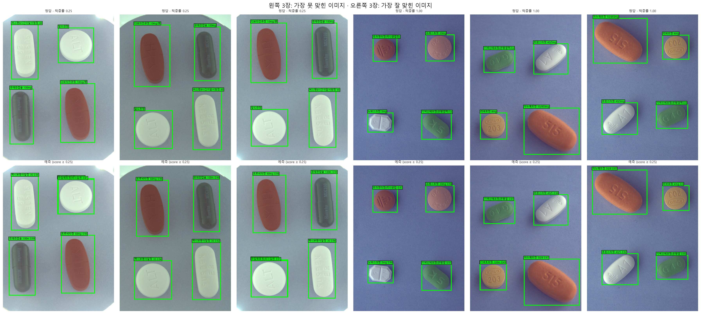</td>
<td width="50%">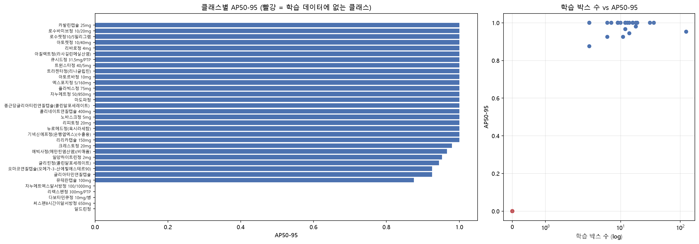</td>
</tr>
<tr>
<td align="center"><sub>위: 정답 · 아래: 예측. 위치는 모두 맞고, 처음 보는 약을 비슷한 약으로 예측</sub></td>
<td align="center"><sub>빨강 = 학습에 없는 약. 점수 손실의 전부가 여기서 나온다</sub></td>
</tr>
</table>

| 발견 | 근거 | 다음 결정 |
|:---|:---|:---|
| 오류는 **위치가 아니라 처음 보는 약의 이름** | 학습한 약 AP 0.985 / 처음 보는 약 5종 AP 0.000 | 위치(알약)와 이름(약 종류)을 나눠 푸는 **2단계 모델** 설계 |
| 처음 보는 약을 **비슷한 약으로 확신** | 다보타민큐정 → 트루비타정 (0.96) | 희귀 약 보강: **Copy-Paste 합성** (E3) |
| 이미지당 상위 4개 제한은 **오히려 손해** | mAP50-95 0.835 → 0.822 | 가설 기각. 제출에는 모든 예측 유지 |
| 두 평가 방식이 일치 | Ultralytics 0.834 vs 직접 구현 COCO 0.835 | 직접 구현한 평가로 앙상블·2단계 모델까지 같은 기준 비교 |

### 분류기 비교: VGG16 · ResNet50 · EfficientNet-B0 (5-Fold)
2단계 모델의 약 이름 판별기 후보를 **같은 조건(같은 증강·학습 설정)에서 구조만 바꿔** 5-Fold로 비교했다.
정답 박스 crop · 학습한 약만으로 평가한 값이라 end-to-end 성능의 **상한**에 해당한다.

| 분류기 | 정확도 | 정밀도 (macro) | 재현율 (macro) | **F1 (macro)** | log loss | 학습 시간 | 파라미터 |
|:---|:---:|:---:|:---:|:---:|:---:|:---:|:---:|
| **EfficientNet-B0** | 0.993 ± 0.008 | **0.994** | **0.995** | **0.994 ± 0.006** | 0.166 | **2.1분** | **4.1M** |
| VGG16 | 0.993 ± 0.008 | 0.990 | 0.989 | 0.989 ± 0.015 | **0.153** | 5.5분 | 134.5M |
| ResNet50 | 0.992 ± 0.009 | 0.987 | 0.988 | 0.987 ± 0.015 | 0.217 | 2.1분 | 23.6M |

→ **EfficientNet-B0 선택**: F1이 가장 높고, VGG16의 1/33 파라미터로 2.6배 빠르다. (log loss는 VGG16이 가장 낮아 확신도는 근소하게 높다)

### 효과가 없었던 시도 (음성 결과)
| 시도 | fold 0 mAP50-95 | E0 대비 | 해석 |
|:---|:---:|:---:|:---|
| Copy-Paste 합성 400장 추가 | 0.823 | −0.012 | 합성(400장)이 원본(185장)의 2배를 넘어 합성 특유의 경계·배경 차이를 학습했을 가능성. 비율을 낮춘 재실험 후보 |
| 2단계 (YOLO + 분류기, 혼합 비율 0 / 0.3 / 0.5) | 0.832 ~ 0.834 | −0.002 | YOLO 단독이 이미 학습한 약을 IoU 0.5에서 100% 맞혀 분류기가 더할 여지가 없다 |
| 1-클래스 검출기 (위치만) | 위치 0.939 | – | 56-클래스 YOLO의 위치 성능(클래스 무시 평가 0.962)보다 낮다 → 클래스 정보가 위치 학습에도 도움 |

**결론** – 이 데이터에서는 **단일 YOLO가 이미 상한에 가깝고**, 남은 개선 여지는 박스 정밀도(앙상블)와 학습 데이터 전체 활용(5-Fold·전체 학습)이다.
fold 0의 mAP50 상한은 학습한 약 28/33종 = **0.848**이고 모든 모델이 0.847이다. 5개 모델 WBF 앙상블은 mAP50-95 **0.841**로 단일 최고(0.839)보다 높았다.

### 희귀 약 보강: Copy-Paste 합성
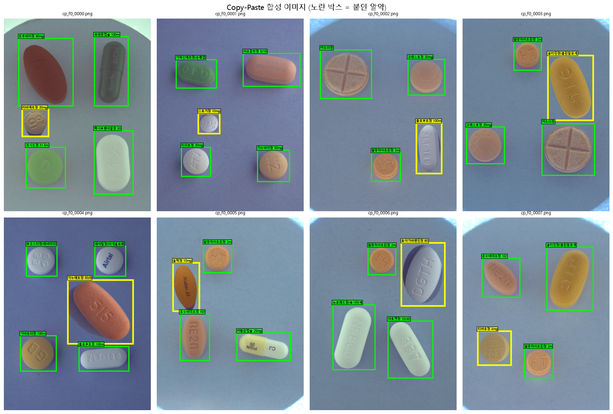
<p align="center"><sub>노란 박스 = 다른 사진에서 오려 붙인 알약. 희귀할수록 자주 뽑고(확률 ∝ 1/√빈도), 90° 회전·뒤집기·크기 ±10%. fold별로 학습 이미지만 사용해 누수 없음</sub></p>

<br>

## 8. 프로젝트 구조

```
ai-project-01-pill-detection/
├── src/pilldet/                # 📦 공통 코드 패키지 (노트북·스크립트가 함께 사용)
│   ├── config.py               #   경로 자동 탐색 (로컬 · Kaggle), seed, fold 수
│   ├── data.py                 #   라벨 병합, 이미지 로딩, 파일명 파싱
│   ├── boxes.py                #   좌표 변환, IoU, YOLO ↔ 픽셀 변환
│   ├── segment.py              #   배경 차분 기반 알약 분할
│   ├── clean.py                #   라벨 감사 · 규칙 기반 수정 · 무결성 검사
│   ├── split.py                #   조합 단위 Stratified Group K-Fold
│   ├── export.py               #   YOLO / COCO 내보내기 · 왕복 검증
│   ├── augment.py              #   Copy-Paste 합성 (희귀 약 보강)
│   ├── train.py                #   설정 파일 기반 YOLO 학습
│   ├── predict.py              #   예측 · 도메인 후처리
│   ├── evaluate.py             #   COCO mAP · 클래스별 AP
│   ├── submission.py           #   Kaggle 제출 파일 생성 · 형식 검사
│   └── viz.py                  #   한글 폰트, 박스 시각화
├── scripts/
│   ├── prepare_data.py         # ⚙️ 데이터 준비 전체를 한 번에 실행
│   ├── make_copy_paste.py      # ⚙️ fold별 Copy-Paste 합성 데이터 생성
│   └── run_experiment.py       # ⚙️ 학습 → 평가 → 제출 파일 → 실험 기록
├── tests/
│   └── test_core.py            # ✅ 핵심 함수 단위 테스트 (14개)
├── notebooks/                  # 📓 분석 과정 · 실행 결과 · 해석
│   ├── 01_eda.ipynb            #   탐색적 데이터 분석 → 의사결정
│   ├── 02_preprocess.ipynb     #   라벨 정제 · YOLO/COCO 변환 · 5-Fold (핵심 함수 코드 포함)
│   └── 03_baseline.ipynb       #   베이스라인 학습 결과 · 오류 분석 · 첫 제출
├── configs/                    # 실험 설정 (실험 하나 = 파일 하나) · 제출 형식
├── reports/
│   ├── figures/                # 분석 그래프 (보고서용)
│   ├── logs/                   # 스크립트 · 테스트 실행 로그
│   ├── label_fixes.csv         # 라벨 수정 내역
│   ├── class_map.csv           # 약 코드 ↔ YOLO 클래스 번호
│   ├── folds.csv               # 이미지별 fold
│   └── annotations_clean.json  # 정제된 COCO 라벨
└── docs/
    ├── PLAN.md                 # 계획서 · 요구사항 추적 · 실험 기록
    └── worklog/                # 일별 업무일지
```

**설계 원칙**: 로직은 `src/pilldet`에 한 번만 구현하고, 노트북은 그것을 불러 **과정과 결과를 설명**하며, 스크립트는 같은 로직을 **자동으로 실행**한다. 그래서 노트북과 스크립트의 결과가 항상 같다.

<br>

## 9. 실행 방법

<details open>
<summary><b>Kaggle Notebook (권장)</b></summary>

1. Kaggle에서 노트북을 Import 한다 (File → Import Notebook)
2. 오른쪽 패널 **Add Input**에서 대회 데이터를 연결한다. 데이터 경로는 `/kaggle/input`에서 자동으로 찾는다
3. Settings → **Internet On** (공통 코드 내려받기, 한글 폰트 설치용) → **Run All**. 노트북이 이 레포를 자동으로 clone 해서 `src/pilldet`을 불러온다
4. `01_eda` → `02_preprocess` 순서로 실행한다. 결과물은 `/kaggle/working/`에 저장된다

</details>

<details>
<summary><b>로컬</b></summary>

```bash
pip install -r requirements.txt
python scripts/prepare_data.py      # 데이터 준비 전체 실행 (약 10초)
python scripts/make_copy_paste.py --fold 0 --n 400                 # Copy-Paste 합성 (약 45초)
python scripts/run_experiment.py --config configs/e0_baseline.yaml # 실험 1회 (RTX 3060 기준 약 6분)
python -m pytest tests -v           # 단위 테스트
```

데이터 폴더를 레포 옆(`../sprint_ai_project1_data`)에 두면 자동으로 찾는다. 다른 위치라면 `--data-dir` 옵션이나 환경 변수 `PILL_DATA_DIR`로 지정한다.
실행 로그: [`reports/logs/prepare_data.log`](reports/logs/prepare_data.log) · [`reports/logs/pytest.log`](reports/logs/pytest.log)

</details>

> ⚠️ **데이터 사용 규칙** – AI Hub `경구약제조합 5000종`의 `TL_2_조합.zip`, `TS_2_조합.zip`은 대회 데이터의 원본이므로 사용하지 않는다. 원본 데이터는 레포에 포함하지 않는다.

<br>

## 10. 진행 기록

| 문서 | 내용 |
|:---|:---|
| 📅 [일정표](docs/PLAN.md) | 날짜별 할 일 · 마감 · 실험 기록 표 |
| 📝 [업무일지](docs/worklog) | 매일의 작업 · 고민 · 실수와 교훈 |
| 📄 보고서 PDF | 작성 예정 |

<br>

<div align="center">
<sub>Made by <a href="https://github.com/lee-da-gyo">@lee-da-gyo</a> · Codeit AI Sprint 15기</sub>
</div>
