<div align="center">

# 💊 경구약제 이미지 객체 검출

**사진 한 장에서 최대 4개 알약의 종류와 위치를 찾아내는 Object Detection 프로젝트**

<sub>Codeit AI Sprint 15기 · 초급 프로젝트 (개인) · 2026.10.27 – 2026.11.06</sub>

<br>


<br>

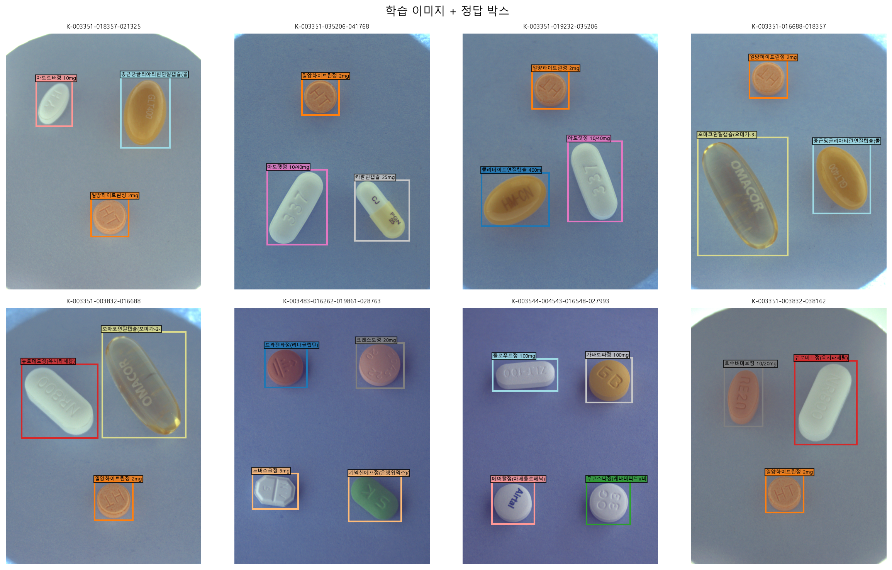

</div>

<br>

## 📑 목차
1. [프로젝트 개요](#1-프로젝트-개요)
2. [핵심 성과](#2-핵심-성과)
3. [파이프라인](#3-파이프라인)
4. [데이터 분석 (EDA)](#4-데이터-분석-eda)
5. [데이터 정제](#5-데이터-정제)
6. [검증 전략](#6-검증-전략)
7. [모델링 및 실험](#7-모델링-및-실험)
8. [프로젝트 구조](#8-프로젝트-구조)
9. [실행 방법](#9-실행-방법)
10. [진행 기록](#10-진행-기록)

<br>

## 1. 프로젝트 개요

> 헬스케어 스타트업 **헬스잇(Health Eat)** 의 AI 엔지니어로서, 사용자가 복용 중인 약을 촬영하면
> 어떤 약인지 자동으로 인식하는 모델을 만든다. 이를 통해 **함께 복용하면 안 되는 약 안내** 같은 헬스케어 서비스로 확장할 수 있다.

| 항목 | 내용 |
|:---|:---|
| **과제** | 객체 검출 (Object Detection) – 클래스 + 바운딩 박스 |
| **입력** | 알약 3~4개가 놓인 사진 (976 × 1280) |
| **출력** | 각 알약의 약 종류(56종)와 위치 |
| **데이터** | 학습 232장 (박스 771개) · 테스트 842장 |
| **평가** | Kaggle Private Competition |
| **환경** | 로컬 RTX 3060 12GB (학습·실험) · Kaggle Notebook (EDA·전처리 노트북 실행 확인) |

<br>

## 2. 핵심 성과

<table>
<tr>
<td width="33%" align="center">

### 🔍 15건
**라벨 오류 발견·수정 (14장)**

<sub>범위 밖 1 · 엉뚱한 위치 1 · 누락 8 · 같은 좌표 3 · 교환 1장(2박스)<br>자동 탐지 + 다른 각도 사진과 대조한 육안 확인</sub>

</td>
<td width="33%" align="center">

### 🛡️ 0건
**같은 조합의 검증 누수**

<sub>같은 조합의 다른 각도 사진을<br>조합 단위 K-Fold로 분리</sub>

</td>
<td width="33%" align="center">

### 🎯 0.950
**최종 후보의 5-Fold OOF mAP@[0.75:0.95] (대회 표기 기반 내부 대리지표)**

<sub>YOLO11s + YOLO11m WBF · 학습 가능 37종 조건부 진단값<br>(단일 모델 0.938) · Kaggle 점수는 제출 후 기록</sub>

</td>
</tr>
</table>

<br>

## 3. 파이프라인

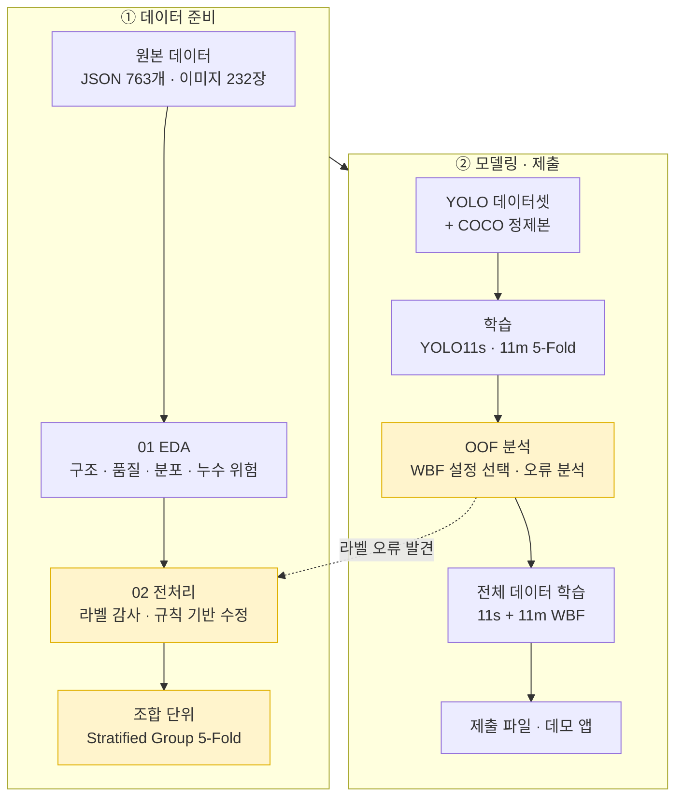

<sub>노란색: 이 프로젝트의 핵심 설계 · 점선: 오류 분석에서 찾은 라벨 오류를 정제 단계로 되돌려 고치고 전체를 다시 학습했다</sub>

<br>

## 4. 데이터 분석 (EDA)

📓 [`notebooks/01_eda.ipynb`](notebooks/01_eda.ipynb)

### 주요 발견과 의사결정

| 발견 | 근거 | 결정 |
|:---|:---|:---|
| **데이터가 매우 적다** | 학습 232장으로 테스트 842장 예측 | 사전학습 YOLO 파인튜닝 |
| **심한 클래스 불균형** | 최대 157개 vs 최소 3개 (약 50배), 56종 중 29종이 10개 미만 | Copy-Paste 증강, 클래스별 AP 확인 |
| **극소수 클래스** | 17종은 같은 장면을 각도만 바꾼 3장이 전부 | 사실상 1장짜리 클래스 → 증강으로 맥락 다양화 |
| **같은 조합을 여러 각도로** | 114개 조합을 최대 세 각도(70°/75°/90°)로 촬영. 실제로는 조합당 1~3장 (3장 40 · 2장 38 · 1장 36조합) | 이미지 단위 분할은 누수 → **조합 단위 분할** |
| **고정된 배치 위치** | 박스 중심이 몇 개 슬롯에 집중 | 이동·모자이크 증강으로 위치 편향 방지 |
| **Train/Test 분포 차이** | Test가 약간 어둡고(131.5 → 125.9) 대비가 큼 | 밝기·대비·색조 증강 |

<table>
<tr>
<td width="50%">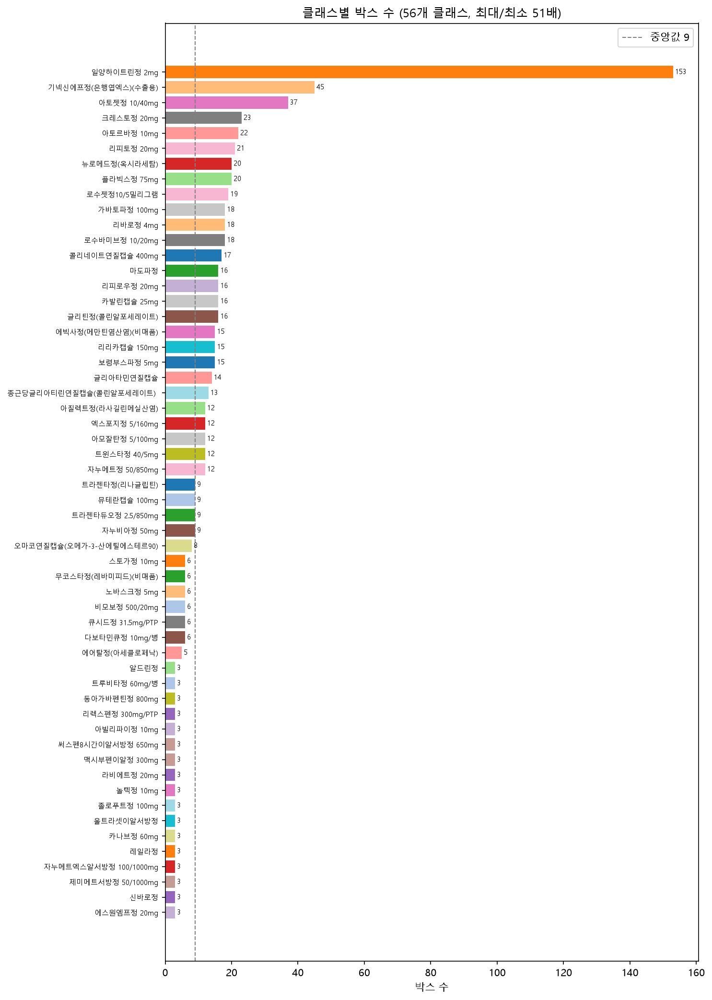</td>
<td width="50%">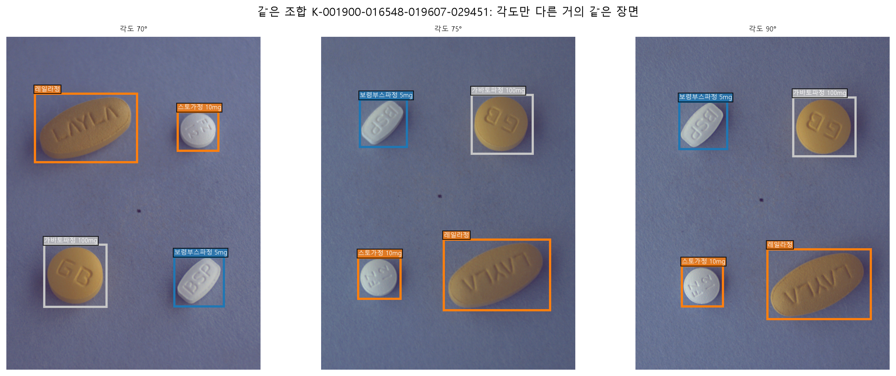</td>
</tr>
<tr>
<td align="center"><sub>클래스별 박스 수 – 롱테일 분포</sub></td>
<td align="center"><sub>같은 조합을 각도만 바꿔 촬영 → 누수 위험</sub></td>
</tr>
</table>

<details>
<summary><b>📊 더 많은 분석 그래프 보기</b></summary>
<br>

| 바운딩 박스 통계 | 클래스별 알약 생김새 |
|:---:|:---:|
| 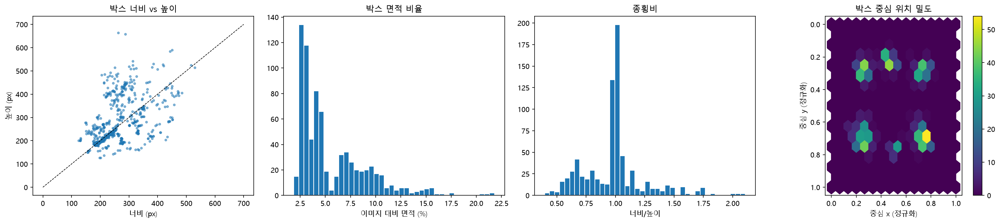 | 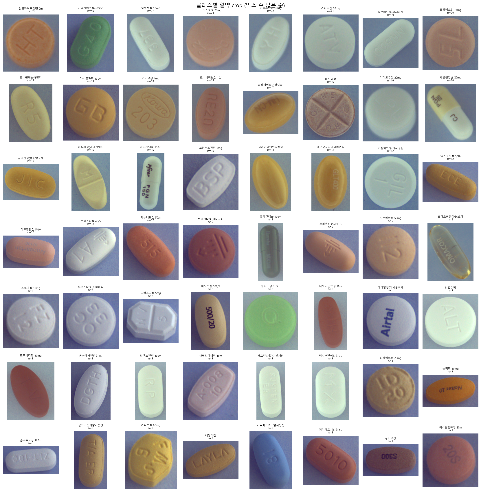 |
| **촬영 조건** | **Train vs Test 이미지 통계** |
| 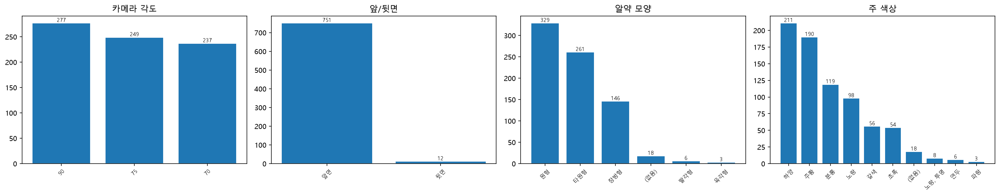 | 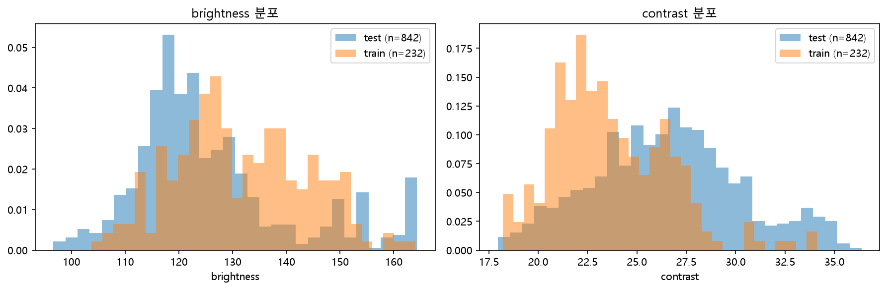 |

</details>

<br>

## 5. 데이터 정제

📓 [`notebooks/02_preprocess.ipynb`](notebooks/02_preprocess.ipynb) · 📄 [`reports/label_fixes.csv`](reports/label_fixes.csv) · ✅ [검수 기록](docs/LABEL_REVIEW.md)

라벨을 검증할 **라벨과 독립적인 기준**이 필요했다. 배경이 단색에 가깝다는 EDA 결과를 이용해,
배경 차분(Lab 색 거리 + Otsu 이진화)으로 알약 영역을 분할하고 라벨과 대조했다.

| 오류 유형 | 탐지 규칙 | 수정 | 건수 |
|:---|:---|:---|:---:|
| **범위 밖 박스** | 좌표가 이미지 밖 (x = 6567) | 숫자 하나를 뺀 후보 중 라벨 없는 알약과 가장 잘 맞는 값 → x = 567 | 1 |
| **엉뚱한 위치 박스** | 박스 안이 배경 + 겹치지 않는 같은 크기의 라벨 없는 알약 존재 | 그 알약 위치로 이동 | 1 |
| **누락 박스** | 파일명의 약 코드 중 라벨 없는 것 1개 + 라벨 없는 알약 1개 | 해당 코드로 박스 추가 | 8 |
| **다른 약끼리 같은 좌표** * | 한 이미지에서 다른 약 박스 쌍의 IoU ≥ 0.9 (후보만 자동 탐지) | 다른 각도 사진으로 확인한 틀린 라벨을 라벨 없는 알약으로 이동 | 3 |
| **라벨 교환** * | OOF 예측이 정답과 신뢰도 0.9 이상으로 다르게 답함 (모델 보조 사후 감사) | 다른 각도 사진으로 확인한 두 박스의 약 코드 교환 | 1장 (2박스) |

<sub>* 오류 분석 뒤에 추가한 감사. 앞의 네 유형은 모델 예측을 쓰지 않는 데이터 내부 감사이고, 라벨 교환은 모델 예측으로 후보를 만든 비독립 감사다.
후보는 자동으로 고치지 않고, 사람이 확인한 결정([`configs/label_review.csv`](configs/label_review.csv): 검수자 · 검수일 · 검수 때 본 두 박스 좌표)만 파이프라인이 적용한다. 현재 라벨이 그 좌표와 같을 때만 적용하므로 다시 실행해도 결과가 같다. 후보 전체와 확인 결과: [`label_audit_candidates.csv`](reports/label_audit_candidates.csv)</sub>

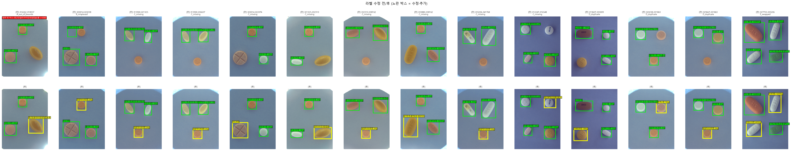
<p align="center"><sub>위: 원본 라벨 · 아래: 정제 라벨 (노란 박스 = 수정·추가)</sub></p>

> **🔁 실패에서 배운 점** — 처음 만든 "빈 박스 이동" 규칙은 6건을 고쳤지만 **5건이 오탐**이었다.
> 반투명 캡슐과 파란 알약은 분할이 잘 안 돼서 박스가 비어 보였던 것이다.
> "원래 박스와 겹치지 않고 크기가 비슷한 알약"이라는 조건을 더해 진짜 오류 1건만 남겼다.
> **자동 규칙의 결과는 반드시 눈으로 검수한다.**

> **🔁 처음 정제가 놓친 오류** — 처음 무결성 검사는 "같은 약 박스의 중복"만 확인해, **서로 다른 약 두 개가 같은 좌표에 라벨된 경우**를 통과시켰다.
> 오류 분석에서 "학습한 약을 신뢰도 0.98로 틀렸다"고 나온 사례를 원본과 대조하다가, 실제로는 **모델이 맞고 라벨이 틀린 4장**을 찾았다.
> 4장을 고친 뒤 5-Fold와 최종 모델을 **모두 다시 학습**했다. 아래 모든 5-Fold·OOF·제출 수치는 수정된 라벨 기준이다 (수정 전 기록은 Git 이력 `a0ef2ce` 이전).

**최종 무결성 검사 (모두 `assert` 통과)**
- ✅ 모든 이미지에서 파일명의 약 목록 = 라벨의 약 목록
- ✅ 범위 밖 박스 0 · 크기 0 박스 0 · 같은 약 중복 0 · 결정이 없는 다른 약끼리 같은 좌표(IoU ≥ 0.9) 0
- ✅ YOLO 라벨 → 픽셀 좌표 왕복 변환 오차 < 0.001px

<br>

## 6. 검증 전략

같은 알약 조합을 각도만 바꿔 찍은 사진이 학습과 검증에 나뉘어 들어가면, 모델은 **거의 같은 장면을 다시 맞히는 셈**이 되어 점수가 부풀려진다. 아래 설계로 **같은 조합에 의한 누수**를 막는다.

- **Group** = 조합(combo): 한 조합의 모든 사진을 같은 fold에 넣는다
- **Stratify** = 이미지의 가장 희귀한 클래스: 희귀 클래스를 fold에 고르게 분산
- 최종 제출 모델은 232장 **전체**로 학습하고, K-Fold는 실험 비교에 쓴다

| Fold | 검증 이미지 | 검증 조합 | 검증 박스 | 학습에 없는 클래스 |
|:---:|:---:|:---:|:---:|:---:|
| 0 | 47 | 23 | 156 | 5 |
| 1 | 46 | 22 | 153 | 3 |
| 2 | 46 | 23 | 150 | 1 |
| 3 | 46 | 22 | 153 | 7 |
| 4 | 47 | 24 | 159 | 3 |

<sub>"학습에 없는 클래스"는 한 조합에만 등장하는 17종 때문에 생긴다. 새로운 조합에 대한 일반화 성능을 정직하게 재는 설정이다.</sub>

> **한계와 대응** – 층화 기준이 "이미지의 가장 희귀한 클래스 하나"라서 다중 라벨을 완전히 반영하지 못하고, fold마다 처음 보는 클래스 수가 1~7개로 다르다.
> 이미 진행한 실험과의 비교를 유지하려고 분할은 바꾸지 않았다. 대신 fold 하나의 결과로 결론 내리지 않고, 최종 후보는 **5-Fold 평균·표준편차**로 판단한다.
> 전체 데이터로 학습하는 최종 모델은 검증 데이터가 학습에 포함되므로 검증 점수로 고르지 않고, 교차검증으로 정한 **고정 에포크**로 학습해 마지막 가중치를 쓴다.

<br>

## 7. 모델링 및 실험

📓 [`notebooks/03_baseline.ipynb`](notebooks/03_baseline.ipynb) · 📄 [`reports/experiments.csv`](reports/experiments.csv) · ⚙️ [`configs/`](configs)

> **한 번에 한 가지만 바꿔** 점수 변화의 원인을 설명할 수 있게 한다.
> ⚠️ 아래 fold 0 탐색(E0~E3, 분류기, 2단계, Copy-Paste)은 오류 분석에서 원본 라벨 오류 4장을 찾기 **전** 기록이다. 0.01 이상의 차이만 결론에 썼고,
> 라벨 수정 뒤 다시 학습한 5-Fold 비교(아래 "5-Fold 교차검증"부터)와 직접 비교하지 않는다. 수정 후 E0 fold 0은 0.836이다.
> 실험 하나 = 설정 파일 하나. `python scripts/run_experiment.py --config configs/<실험>.yaml` 한 줄로 학습 → 평가 → 제출 파일 → 기록까지 실행된다.

| ID | 변경 사항 | val mAP50 | **val mAP50-95** | (보조) 학습한 약만 | Kaggle | 학습 시간 |
|:---:|:---|:---:|:---:|:---:|:---:|:---:|
| E0 | 베이스라인: YOLO11s · 640px · 기본 증강 | 0.847 | 0.835 | 0.985 | – | 5.7분 |
| E1 | 해상도 960px | 0.824 | 0.811 | 0.955 | – | 11.6분 |
| E1 | 해상도 1280px | 0.837 | 0.830 | 0.978 | – | 41.3분 |
| E2 | 모델 크기 YOLO11n | 0.842 | 0.823 | 0.970 | – | 6.3분 |
| E2 | 모델 크기 **YOLO11m** | 0.847 | **0.839** | 0.989 | – | 30.8분* |
| E2 | 최신 구조 YOLO26s | 0.828 | 0.810 | 0.955 | – | 4.3분 |
| E3 | 상하 뒤집기 증강 | 0.847 | 0.833 | 0.981 | – | 5.3분 |
| E3 | 밝기 증강 강화 (hsv_v 0.4 → 0.6) | 0.847 | 0.837 | 0.986 | – | 5.6분 |

<sub>* YOLO11m은 다른 학습과 GPU를 함께 쓰던 구간이 있어 시간이 부풀려졌다. 해상도 실험은 VRAM 때문에 batch를 줄였지만 Ultralytics가 nbs=64로 기울기를 누적해 유효 배치는 같다.</sub>

**중간 해석** – 해상도를 키우거나 최신 구조(YOLO26)로 바꿔도 좋아지지 않았고, 모델 크기는 n < s < m 순으로 조금씩 좋아졌다.
증강 두 가지는 E0과 ±0.002 차이라 효과를 판단할 수 없다. fold 0 하나(독립 조합 23개)로는 0.005 이하의 차이를 구분할 수 없으므로,
**최종 후보(YOLO11s, YOLO11m)는 5-Fold OOF(232장 전체를 한 번씩 검증)로 다시 비교**한다 → [`scripts/summarize_cv.py`](scripts/summarize_cv.py)

<sub>**주 지표는 val mAP50-95**다. val = 조합 단위 fold 0 (47장, 독립 조합 23개)이라 0.01~0.02 차이는 우연일 수 있어, 최종 후보는 5-Fold로 다시 확인한다.
"(보조) 학습한 약만"은 학습 fold에 있는 클래스만으로 다시 평가한 **조건부 진단 지표**다. 가장 어려운 "처음 보는 약"을 빼서 낙관적이므로 모델 선택에는 쓰지 않고, 오류가 어디서 오는지 나눠 보는 데만 쓴다.</sub>

### 베이스라인에서 얻은 핵심 발견
<table>
<tr>
<td width="50%">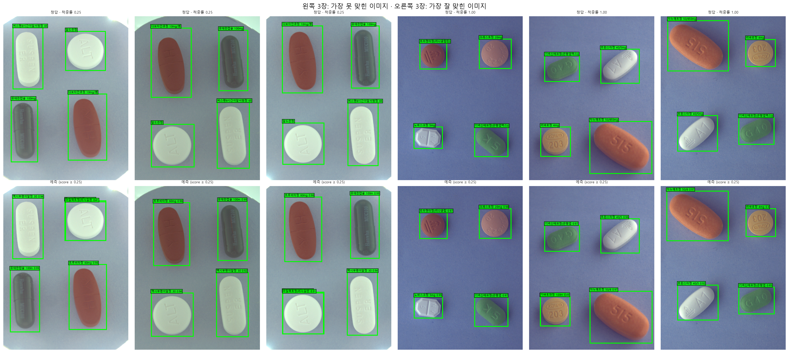</td>
<td width="50%">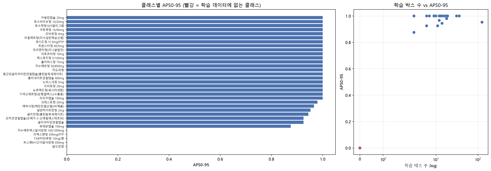</td>
</tr>
<tr>
<td align="center"><sub>위: 정답 · 아래: 예측. 위치는 모두 맞고, 처음 보는 약을 비슷한 약으로 예측</sub></td>
<td align="center"><sub>빨강 = 학습에 없는 약. 점수 손실의 전부가 여기서 나온다</sub></td>
</tr>
</table>

| 발견 | 근거 | 다음 결정 |
|:---|:---|:---|
| 오류는 **위치가 아니라 처음 보는 약의 이름** | 학습한 약 AP 0.985 / 처음 보는 약 5종 AP 0.000 | 위치(알약)와 이름(약 종류)을 나눠 푸는 **2단계 모델** 설계 |
| 처음 보는 약을 **비슷한 약으로 확신** | 다보타민큐정 → 트루비타정 (0.96) | 희귀 약 보강: **Copy-Paste 합성** (E3) |
| 이미지당 상위 4개 제한은 **오히려 손해** | mAP50-95 0.835 → 0.822 | 가설 기각. 제출에는 모든 예측 유지 |
| 두 평가 방식이 일치 | Ultralytics 0.834 vs 직접 구현 COCO 0.835 | 직접 구현한 평가로 앙상블·2단계 모델까지 같은 기준 비교 |

### 분류기 비교: VGG16 · ResNet50 · EfficientNet-B0 (5-Fold)
2단계 모델의 약 이름 판별기 후보를 **같은 조건(같은 증강·학습 설정)에서 구조만 바꿔** 5-Fold로 비교했다.
정답 박스 crop · 학습한 약만 · 같은 fold로 최고 에포크를 골라 평가한 값이라, 실제 검출 성능이 아니라 **낙관적인 분류기 구성요소 진단값**이다.

| 분류기 | 정확도 | 정밀도 (macro) | 재현율 (macro) | **F1 (macro)** | log loss | 학습 시간 | 파라미터 |
|:---|:---:|:---:|:---:|:---:|:---:|:---:|:---:|
| **EfficientNet-B0** | 0.993 ± 0.008 | **0.994** | **0.995** | **0.994 ± 0.006** | 0.166 | **2.1분** | **4.1M** |
| VGG16 | 0.993 ± 0.008 | 0.990 | 0.989 | 0.989 ± 0.015 | **0.153** | 5.5분 | 134.5M |
| ResNet50 | 0.992 ± 0.009 | 0.987 | 0.988 | 0.987 ± 0.015 | 0.217 | 2.1분 | 23.6M |

→ **EfficientNet-B0 선택**: F1이 가장 높고, VGG16의 1/33 파라미터로 2.6배 빠르다. (log loss는 VGG16이 가장 낮아 확신도는 근소하게 높다)

### 효과가 없었던 시도 (음성 결과)
| 시도 | fold 0 mAP50-95 | E0 대비 | 해석 |
|:---|:---:|:---:|:---|
| Copy-Paste 합성 400장 추가 | 0.823 | −0.012 | **이 설정(합성 400장)만 기각.** 합성이 원본(185장)의 2배를 넘어 합성 특유의 경계·배경 차이를 학습했을 가능성. 비율을 낮춘 재실험 후보 |
| 2단계 (E0 검출 박스 + 분류기, 혼합 비율 0 / 0.3 / 0.5) | 0.832 ~ 0.834 | −0.002 | fold 0에서 YOLO 단독이 이미 학습한 약을 IoU 0.5에서 거의 다 맞혀 분류기가 더할 여지가 없었다. 전용 1-클래스 검출기와의 조합은 아직 미검증 |
| 1-클래스 검출기 (위치만) | 위치 0.939 | – | 56-클래스 YOLO의 위치 성능(클래스 무시 평가 0.962)보다 낮다 → 클래스 정보가 위치 학습에도 도움 |

**중간 결론** – fold 0 검증에는 학습 fold에 없는 약이 5종 있어, 이 분할에서 얻을 수 있는 mAP50의 최댓값은 28/33 = **0.848**이다.
강한 후보들(E0 · YOLO11m · 밝기 증강 · 상하 뒤집기)의 mAP50이 0.847로 **이 분할 상한에 거의 도달**했다.
이는 fold 분할이 만든 open-set 상한일 뿐, 56종을 모두 학습하는 최종 모델이나 Kaggle 점수의 상한은 아니다.
따라서 fold 0 하나로 모델을 고르지 않고 5-Fold OOF로 다시 비교하며, 남은 개선 여지는 박스 정밀도(앙상블)와 학습 데이터 전체 활용이다.
5개 모델 WBF 앙상블은 mAP50-95 **0.841**로 단일 최고(0.839)보다 높았다 ([`wbf_fold0.csv`](reports/experiments/wbf_fold0.csv)). 다만 같은 fold에서 조합을 고르고 평가했으므로 5-Fold에서 다시 확인한다.

> **평가 지표** – 대회 페이지의 표기는 **mAP@[0.75:0.95]**다. 이것을 COCO 관례(0.05 간격 5개, [`configs/evaluation.yaml`](configs/evaluation.yaml))로 해석한 내부 대리지표(이하 대리지표)를 계산하며, 주최 측 평가 코드 또는 공식 점수와의 동등성은 미확인이다. 대회 페이지를 후반에 확인해, 실험 대부분은 COCO 표준 mAP50-95로 비교했다. 확인한 뒤 저장된 예측으로 최종 결정을 대리지표로 다시 평가했고 (WBF IoU 0.7 → 0.6, 차이 0.0007이라 주최 측 해석이 다르면 달라질 수 있다), 37종 조건부 OOF는 WBF 0.950 · YOLO11s 0.938 · YOLO11m 0.922다.

### 5-Fold 교차검증: 최종 후보 비교 (232장 OOF)
| 모델 | fold별 mAP50-95 (0 / 1 / 2 / 3 / 4) | fold 평균 ± 표준편차 | OOF 전체 (56종) | OOF 37종 (조건부) | fold별 best epoch |
|:---|:---:|:---:|:---:|:---:|:---:|
| YOLO11s | 0.836 / 0.900 / 0.936 / 0.763 / 0.879 | 0.863 ± 0.067 | 0.634 | 0.956 | 80 / 81 / 86 / 26 / 59 |
| YOLO11m | 0.837 / 0.900 / 0.924 / 0.732 / 0.884 | 0.855 ± 0.076 | 0.622 | 0.941 | 80 / 90 / 50 / 44 / 80 |
| **WBF 11s + 11m** (2:1, IoU 0.6) | – | – | **0.638** | **0.964** | – |

<sub>수정된 라벨로 다시 학습한 값이다. 수정 전(0.941 / 0.936 / 0.954)과의 차이는 평가 정답도 함께 바뀌었으므로 "정제 효과"로 해석하지 않는다.</sub>

<sub>**OOF 37종 (조건부)** = 2개 이상 fold에 있어 검증될 때 학습에도 있는 37종만으로 다시 잰 값. 한 fold에만 있는 희귀 19종을 정답·예측 양쪽에서 뺐으므로
**모델·앙상블을 같은 조건에서 비교하는 진단값이며, 56종 Kaggle 점수의 추정치가 아니다.**
재현: [`summarize_cv.py`](scripts/summarize_cv.py) → [`cv_summary.csv`](reports/cv_summary.csv) · [`analyze_oof.py`](scripts/analyze_oof.py) → [`oof_analysis.csv`](reports/experiments/oof_analysis.csv), [`wbf_oof.csv`](reports/experiments/wbf_oof.csv), [`wbf_meta_validation.csv`](reports/experiments/wbf_meta_validation.csv)</sub>

| 발견 | 근거 | 결정 |
|:---|:---|:---|
| OOF 전체(0.63)가 fold 평균(0.86)보다 크게 낮은 이유는 **분할 구조** | 56종 중 **19종이 한 fold에만** 있어 검증될 때마다 학습에 없다 → OOF 상한 37/56 = **0.661**. 두 모델 모두 상한의 94~96% | 모델 비교는 같은 조건의 37종 OOF로 한다. 최종 모델은 56종을 모두 학습하지만, 희귀 19종의 실제 성능은 이 검증으로 잴 수 없다 |
| fold 간 편차가 크다 (0.76 ~ 0.94) | 처음 보는 약 수와 점수 순위가 정확히 반대: fold 2는 1종(0.936), fold 1·4는 3종(0.900·0.879), fold 0은 5종(0.836), **fold 3은 7종(0.763)** | fold 하나의 0.005 차이로 결론 내리지 않은 판단이 옳았다 |
| 단일 모델은 YOLO11s가 낫다 | fold 평균 +0.007, 37종 OOF +0.015 모두 11s (라벨 수정 전에는 방향이 엇갈렸다) | 단일 모델이면 더 빠른 11s. 합치면 더 좋아진다 ↓ |
| **두 모델의 WBF가 단일 최고보다 높다** | 37종 OOF 0.956 → **0.964 (+0.008)**. 같은 OOF에서 12개 설정 중 최댓값을 고르면 낙관적이므로, **fold 하나를 보류하고 나머지 4개 fold로 설정을 고르는 근사 메타 검증**을 5번 했다 → **가중치는 5번 모두 2:1**이었다. 대리지표 mAP@[0.75:0.95]로 평가하면 IoU는 0.6이 3번 · 0.7이 2번 뽑혔고 전체 OOF도 0.6이 근소하게 높아(0.9502 vs 0.9495) 0.6을 택했다. 차이가 작아 규칙을 따른 선택이다. 보류 예측 합산 0.949는 독립 성능 추정이 아니라 안정성 점검값이다 ([`wbf_meta_validation.csv`](reports/experiments/wbf_meta_validation.csv)). 단, 설정을 고를 때 쓴 다른 fold의 모델은 보류 fold를 학습에 포함했으므로 완전한 비편향 추정은 아니다. 엄밀한 nested CV는 보류 fold를 뺀 4개 fold 안에서 모델을 다시 학습해야 해 저장된 OOF만으로는 할 수 없다 | 최종 제출 = 11s + 11m WBF (2:1, IoU 0.6). 라벨 수정 전에는 같은 절차가 1:1을 골랐다 – 절차를 고정하고 결과를 따랐다 |

**전체 데이터 학습 에포크 (휴리스틱)** – 검증 없이 232장 전체로 학습하므로 조기 종료 기준이 없다. fold별 best epoch의 **중앙값**(11s 80, 11m 80. 라벨 수정 전 50 · 83)을 쓰고 마지막 가중치(last.pt)를 제출한다.
데이터가 fold 학습보다 25% 많고 학습률 스케줄이 총 에포크에 묶여 있어 최적이라는 보장은 없다. 대신 fold별 학습 기록으로 민감도를 확인했다 ([`epoch_sensitivity.py`](scripts/epoch_sensitivity.py) → [`epoch_sensitivity.csv`](reports/experiments/epoch_sensitivity.csv)).

| 고정 에포크 후보 | YOLO11s: 최고점 대비 평균 손해 | YOLO11m: 최고점 대비 평균 손해 |
|:---|:---:|:---:|
| P25 (59 / 50) | 0.006* | 0.011 |
| **중앙값 (80 / 80)** | **0.003*** | **0.001*** |
| P75 (81 / 80) | 0.004* | 0.001* |

<sub>* 조기 종료로 그 에포크까지 학습하지 않은 fold(주로 처음 보는 약이 7종인 fold 3)는 빠져 유리하게 치우친다.
→ 중앙값의 평균 손해는 0.003 이하지만 **80 에포크까지 학습한 4개 fold에서만 잰 참고값**이다. 11s · 11m 모두 fold 3이 26~44 에포크에서 최고였다가 조기 종료되어 빠졌고,
fold 학습(100 에포크 스케줄)과 최종 학습(80 에포크 스케줄)은 학습률 감소 시점이 달라 평탄성을 입증하지 않는다. 80 에포크는 최적값이 아니라 중앙값 휴리스틱으로만 채택했다.</sub>

### 색 보정 전처리: CLAHE 전후 비교 (5-Fold)
EDA에서 Test가 Train보다 어둡고 대비가 컸다. 이미지마다 국소 대비를 평탄화하는 CLAHE로 이 차이를 줄일 수 있는지 YOLO11s 5-Fold에서 **전처리 하나만 바꿔** 비교했다.
알약 색은 클래스를 가르는 단서라 LAB 밝기 채널에만 적용했고, 설정값은 검증 점수로 고르지 않고 OpenCV 기본값(clip 2.0, tile 8×8)으로 고정했다. 학습·검증·테스트 모두 같은 함수를 거친다.

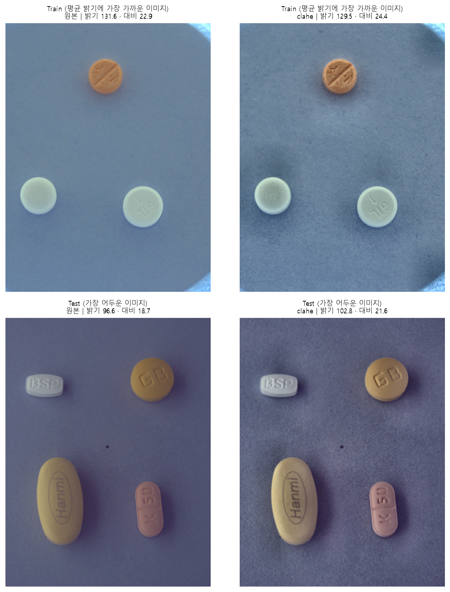

| 측정 | 원본 | CLAHE | 해석 |
|:---|:---:|:---:|:---|
| Test − Train 밝기 차이 | −5.55 | **−3.25** | 밝기 차이는 40% 줄었다 |
| Test − Train 대비 차이 | +2.88 | +2.98 | 대비 차이는 그대로 (둘 다 커져서) |
| fold별 mAP50-95 (0 / 1 / 2 / 3 / 4) | 0.836 / 0.900 / 0.936 / 0.763 / 0.879 | 0.833 / 0.900 / 0.943 / 0.748 / 0.886 | **2개 fold 상승, 3개 fold 하락** |
| fold 평균 | 0.8626 | 0.8618 | −0.0008 |
| OOF 37종 (조건부) | 0.956 | 0.962 | +0.005, 조합 단위 부트스트랩 95% 구간 **−0.003 ~ +0.018** (개선 확률 88%) |

<sub>수정 라벨로 두 실험을 모두 다시 학습한 값이다. 라벨 수정 전에도 2개 fold 상승 · 3개 하락, 37종 OOF +0.011(구간 −0.006 ~ +0.027)로 결론이 같았다.</sub>

<sub>부트스트랩: 같은 약 묶음을 여러 각도로 찍은 이미지는 서로 독립이 아니므로, 분할과 같은 단위인 조합 114개를 복원 추출(1000회)해 두 실험의 차이를 짝지어 계산했다.
재현: [`make_preprocessed.py`](scripts/make_preprocessed.py) → [`preprocess_clahe_stats.csv`](reports/experiments/preprocess_clahe_stats.csv) · [`compare_oof.py`](scripts/compare_oof.py) → [`compare_e0_baseline_vs_e4_clahe.csv`](reports/experiments/compare_e0_baseline_vs_e4_clahe.csv)</sub>

→ **채택하지 않는다.** fold 단위로는 방향이 엇갈리고, 합친 OOF의 개선도 구간이 0을 포함한다.
합친 OOF만 오른 것은 5개 fold 모델의 예측을 한 순위로 섞어 평가하는 방식이라, fold 안의 검출 성능 외에 모델 간 점수 분포 차이도 함께 반영되기 때문일 수 있다 (확인하지 않은 가설).
그림에서 보듯 CLAHE는 배경 질감을 키우고 알약 둘레에 어두운 테두리를 만든다. 밝기 차이는 이미 학습 중 HSV 증강이 다루고 있어 전처리로 얻을 몫이 작았던 것으로 본다.

### 희귀 약 보강: Copy-Paste 합성
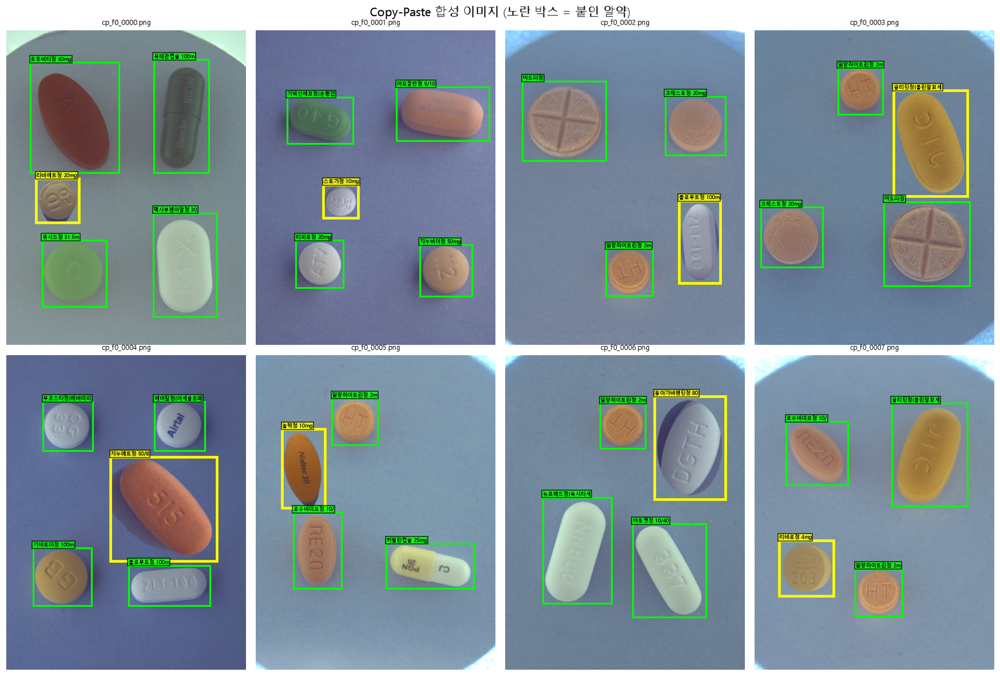
<p align="center"><sub>노란 박스 = 다른 사진에서 오려 붙인 알약. 희귀할수록 자주 뽑고(확률 ∝ 1/√빈도), 90° 회전·뒤집기·크기 ±10%. fold별로 학습 이미지만 사용해 누수 없음</sub></p>

### 학습률 · TTA

**학습률 (R11)** – `optimizer=auto`가 실제로 고른 값(AdamW, lr0 0.000167)을 기준으로 학습률 하나만 3배 · 0.3배로 바꿔 fold 0에서 비교했다.
판단 규칙은 실행 전에 설정 파일에 적어 두었다: *E0보다 0.005 이상 좋을 때만 5-Fold로 확인한다.*

| 학습률 | fold 0 mAP50-95 | E0 대비 | 판단 |
|:---|:---:|:---:|:---|
| 0.000167 (auto, E0) | 0.8356 | – | 기준 |
| 0.0005 (3배) | 0.8381 | +0.0025 | 기준(+0.005) 미달 → 5-Fold 생략 |
| 0.00005 (0.3배) | 0.8269 | −0.0087 | 하락 |

→ auto 값을 유지한다. fold 하나(독립 조합 23개)로는 0.005 이하의 차이를 구분할 수 없다.

**TTA (R14)** – 다시 학습하지 않고, 5-Fold 모델로 검증 예측만 TTA(좌우 뒤집기 + 0.83 · 0.67배 축소)로 다시 만들어 기준 예측과 짝지어 비교했다 ([`predict_oof.py`](scripts/predict_oof.py)).

| 37종 조건부 OOF | TTA 없음 | TTA | 차이 (조합 부트스트랩 95% 구간) | fold별 | 개선 확률 |
|:---|:---:|:---:|:---:|:---:|:---:|
| YOLO11s | 0.956 | 0.952 | −0.004 (−0.011 ~ +0.002) | 3개↑ 2개↓ | 9% |
| YOLO11m | 0.941 | 0.936 | −0.005 (−0.010 ~ +0.002) | 1개↑ 4개↓ | 11% |

→ **채택하지 않는다.** 두 모델 모두 합친 OOF가 내려가고 개선 확률이 10% 안팎이다. 대리지표로 다시 봐도 같았다 (37종 OOF 11s −0.007, 구간 −0.015 ~ +0.002, 3개 fold 상승 · 2개 하락, 개선 확률 7% / 11m −0.012, 구간 −0.018 ~ 0.000, 5개 fold 모두 하락, 개선 확률 3%). 이 데이터는 고정된 카메라로 같은 크기의 알약을 찍어,
축소 변환이 학습 분포에 없는 크기를 만들고 박스 좌표 평균이 IoU 0.95 정밀도를 해쳤을 수 있다 (확인하지 않은 가설).
재현: [`compare_e0_baseline_vs_e0_baseline_tta.csv`](reports/experiments/compare_e0_baseline_vs_e0_baseline_tta.csv), [`compare_e2_yolo11m_vs_e2_yolo11m_tta.csv`](reports/experiments/compare_e2_yolo11m_vs_e2_yolo11m_tta.csv)

### 결과 분석 (현재 최종 후보의 OOF)

현재 최종 후보와 같은 구성(11s + 11m WBF 2:1)의 5-Fold OOF 232장을 나눠 "어디서 점수를 잃는지" 보았다 ([`error_analysis.py`](scripts/error_analysis.py) · 보고서 8장).

| 발견 | 근거 |
|:---|:---|
| 학습 가능 37종은 위치와 이름 모두 거의 맞힌다 | AP50-95 중앙값 0.992, 맞힌 박스의 IoU 중앙값 0.974, 위치 오류·배경 오탐 0 |
| 학습한 약을 틀릴 때는 신뢰도가 낮다 | 분류 오류 12개의 신뢰도 중앙값 0.55, 최댓값 0.82 (0.9 이상 오답 없음) |
| **처음 보는 약은 닮은 약 이름을 높은 신뢰도로 붙인다** | 63박스 중 61개가 다른 약 이름, **24%가 신뢰도 0.9 이상** (예: 다보타민큐정 → 트루비타정 0.98) |
| 신뢰도만으로는 "모르는 약"을 거를 수 없다 | AUROC 0.884 (조합 단위 부트스트랩 95% 구간 0.794~0.955). 처음 보는 약 90%를 거르려면 학습한 약도 28% 거부 (같은 OOF에서 고른 탐색적 값). IoU 0.7에서는 0.842 · 55%로, WBF 설정과 작은 표본(63박스)에 민감하다 |
| 처음 보는 약이 학습한 약의 AP도 깎는다 | 보령부스파정 AP 0.751: 자기 박스는 15개 중 11개를 맞혔지만, 처음 보는 약 5박스가 이 이름으로 예측됨 |

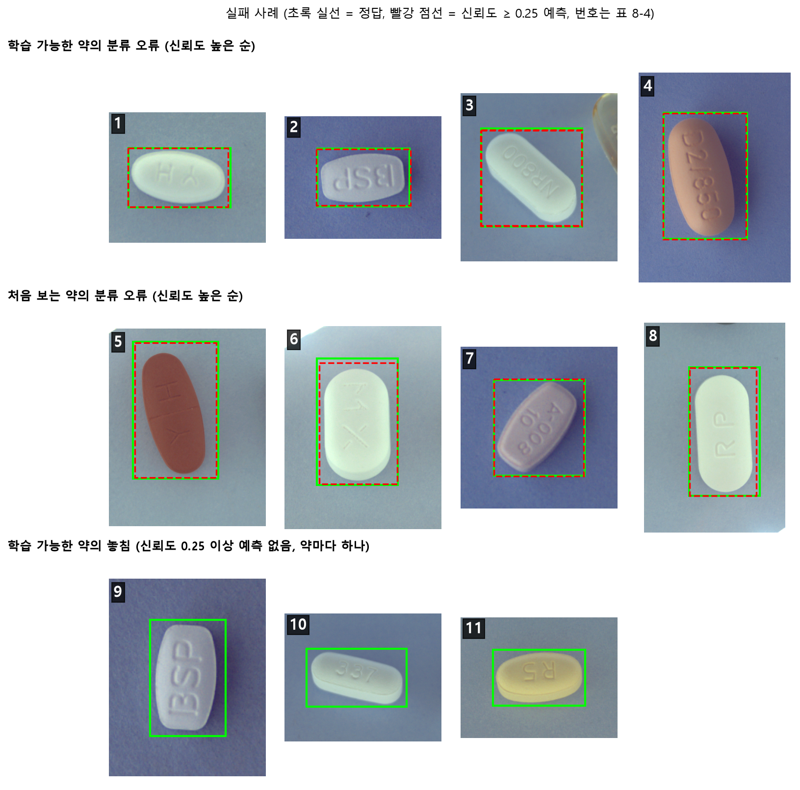

> 이 분석의 첫 버전에서는 "학습한 약끼리도 신뢰도 0.96~0.98로 틀린다"는 결론이 나왔다. 그 사례를 원본과 대조하자 4장 모두 **라벨이 틀린** 경우였고,
> 라벨을 고쳐 전체를 다시 학습한 뒤 그 결론을 철회했다 ([5. 데이터 정제](#5-데이터-정제)).

### 데모 앱

```bash
streamlit run app/demo.py
```

사진을 올리면 알약마다 위치 · 약 이름 · 영문명 · 신뢰도 · 다른 후보를 보여 준다. 신뢰도가 0.5 미만이거나 같은 알약에 이름이 두 개 이상 붙으면 **"확인 필요"**로 표시한다.
위의 분석처럼 처음 보는 약은 높은 신뢰도로도 틀릴 수 있어, 이 표시가 오답을 모두 거르지는 못한다는 경고를 함께 띄운다. 시연 영상은 11/03에 녹화해 여기에 링크한다.

<br>

## 8. 프로젝트 구조

```
ai-project-01-pill-detection/
├── src/pilldet/                # 📦 공통 코드 패키지 (노트북·스크립트가 함께 사용)
│   ├── config.py               #   경로 자동 탐색 (로컬 · Kaggle), seed, fold 수
│   ├── data.py                 #   라벨 병합, 이미지 로딩, 파일명 파싱
│   ├── boxes.py                #   좌표 변환, IoU, YOLO ↔ 픽셀 변환
│   ├── segment.py              #   배경 차분 기반 알약 분할
│   ├── clean.py                #   라벨 감사 · 규칙 기반 수정 · 사람 확인 결정 적용 · 무결성 검사
│   ├── split.py                #   조합 단위 Stratified Group K-Fold
│   ├── export.py               #   YOLO / COCO 내보내기 · 왕복 검증
│   ├── preprocess.py           #   CLAHE 전처리 (학습 · 검증 · 테스트 공통)
│   ├── augment.py              #   Copy-Paste 합성 (희귀 약 보강)
│   ├── train.py                #   설정 파일 기반 YOLO 학습
│   ├── predict.py              #   예측 · 도메인 후처리
│   ├── evaluate.py             #   COCO mAP · 클래스별 AP
│   ├── submission.py           #   Kaggle 제출 파일 생성 · 형식 검사
│   ├── classifier.py           #   VGG16 · ResNet50 · EfficientNet-B0 약 분류기
│   ├── two_stage.py            #   검출 박스 + 분류기 결합 (2단계 모델)
│   ├── ensemble.py             #   Weighted Boxes Fusion 직접 구현
│   └── viz.py                  #   한글 폰트, 박스 시각화
├── scripts/
│   ├── prepare_data.py         # ⚙️ 데이터 준비 전체를 한 번에 실행
│   ├── audit_labels.py         # ⚙️ 라벨 감사 후보: 같은 좌표 중복(데이터) · 고신뢰 불일치(모델 보조)
│   ├── make_copy_paste.py      # ⚙️ fold별 Copy-Paste 합성 데이터 생성
│   ├── make_preprocessed.py    # ⚙️ 전처리 데이터셋 생성 · Train/Test 분포 차이 측정
│   ├── run_experiment.py       # ⚙️ 학습 → 평가 → 제출 파일 → 실험 기록 (--fold, --skip-train)
│   ├── summarize_cv.py         # ⚙️ 5-Fold 점수 · OOF 집계
│   ├── analyze_oof.py          # ⚙️ open-set 상한 분해 · WBF 설정 선택 · 근사 메타 검증
│   ├── epoch_sensitivity.py    # ⚙️ 전체 학습 에포크 민감도
│   ├── compare_oof.py          # ⚙️ 두 실험 OOF 짝지은 비교 · 조합 단위 부트스트랩
│   ├── predict_oof.py          # ⚙️ 학습한 5-Fold 모델로 추론 설정(TTA)만 바꿔 OOF 다시 만들기
│   ├── error_analysis.py       # ⚙️ OOF 오류 분석: 클래스별 AP · IoU별 mAP · 실패 유형 · 처음 보는 약과 신뢰도
│   ├── train_classifier.py     # ⚙️ 분류기 3종 5-Fold 비교
│   ├── eval_two_stage.py       # ⚙️ 2단계 모델 평가
│   └── make_submission.py      # ⚙️ 최종 모델 WBF → 제출 파일
├── app/
│   └── demo.py                 # 🖥️ 데모 앱 (Streamlit): 사진 → 약 이름 · 위치 · 신뢰도 · 확인 필요 표시
├── tests/
│   └── test_core.py            # ✅ 핵심 함수 단위 테스트 (함수 36개 · 케이스 38개)
├── notebooks/                  # 📓 분석 과정 · 실행 결과 · 해석
│   ├── 01_eda.ipynb            #   탐색적 데이터 분석 → 의사결정
│   ├── 02_preprocess.ipynb     #   라벨 정제 · YOLO/COCO 변환 · 5-Fold (핵심 함수 코드 포함)
│   └── 03_baseline.ipynb       #   베이스라인 학습 결과 · 오류 분석 · 첫 제출
├── configs/                    # 실험 설정 (실험 하나 = 파일 하나) · 제출 형식 · 라벨 확인 결정(label_review.csv)
├── reports/
│   ├── figures/                # 분석 그래프 (보고서용)
│   ├── logs/                   # 스크립트 · 테스트 실행 로그
│   ├── label_fixes.csv         # 라벨 수정 내역
│   ├── class_map.csv           # 약 코드 ↔ YOLO 클래스 번호
│   ├── folds.csv               # 이미지별 fold
│   └── annotations_clean.json  # 정제된 COCO 라벨
└── docs/
    ├── PLAN.md                 # 계획서 · 요구사항 추적 · 실험 기록
    ├── LABEL_REVIEW.md         # 라벨 수정 검수 기록
    ├── report/                 # 보고서 원본(HTML·CSS)과 PDF
    └── worklog/                # 일별 업무일지
```

**설계 원칙**: 로직은 `src/pilldet`에 한 번만 구현하고, 노트북은 그것을 불러 **과정과 결과를 설명**하며, 스크립트는 같은 로직을 **자동으로 실행**한다. 그래서 노트북과 스크립트의 결과가 항상 같다.

<br>

## 9. 실행 방법

<details open>
<summary><b>로컬 (전체 파이프라인 · 실험과 제출에 사용)</b></summary>

```bash
pip install -r requirements.txt
python scripts/prepare_data.py                                       # 라벨 정제 · YOLO/COCO 변환 · 5-Fold (약 15초)
python scripts/audit_labels.py                                       # 라벨 감사 후보 (5-Fold 학습 뒤 OOF 필요)
python -m pytest tests -v                                            # 단위 테스트

# 실험 1회 = 설정 파일 1개 (RTX 3060 기준 YOLO11s 약 6분)
python scripts/run_experiment.py --config configs/e0_baseline.yaml   # fold 0
python scripts/run_experiment.py --config configs/e0_baseline.yaml --fold 1   # fold 1~4도 같은 방식

# 5-Fold 분석
python scripts/summarize_cv.py e0_baseline e2_yolo11m                # fold별·OOF 점수
python scripts/analyze_oof.py e0_baseline e2_yolo11m                 # open-set 상한 분해 · WBF 설정 선택 · 근사 메타 검증
python scripts/epoch_sensitivity.py e0_baseline e2_yolo11m           # 전체 학습 에포크 민감도

# 전처리 비교 (CLAHE): 데이터셋 생성 → 5-Fold (fold 1~4는 --fold) → 기준과 짝지은 비교
python scripts/make_preprocessed.py --method clahe
python scripts/run_experiment.py --config configs/e4_clahe.yaml
python scripts/compare_oof.py e0_baseline e4_clahe
python scripts/error_analysis.py                                     # 현재 최종 후보(11s+11m WBF) OOF 오류 분석

# 최종 모델 (232장 전체 · 검증 없음 · last.pt) → 제출 파일
python scripts/run_experiment.py --config configs/final_yolo11s.yaml
python scripts/run_experiment.py --config configs/final_yolo11m.yaml
python scripts/make_submission.py --runs final_yolo11s final_yolo11m --weights 2 1 --iou-thr 0.6 --name final_11s_11m_wbf_iou06

# 학습률(R11) · TTA(R14) 비교
python scripts/run_experiment.py --config configs/e5_lr_high.yaml   # fold 0, e5_lr_low도 같은 방식
python scripts/predict_oof.py e0_baseline --tta                      # 학습 없이 TTA로 OOF만 다시 → compare_oof.py로 비교

# 보고서 PDF · 데모 앱
python scripts/build_report.py                                       # docs/report/report.pdf (Edge 인쇄 엔진)
streamlit run app/demo.py
```

데이터 폴더를 레포 옆(`../sprint_ai_project1_data`)에 두면 자동으로 찾는다. 다른 위치라면 `--data-dir` 옵션이나 환경 변수 `PILL_DATA_DIR`로 지정한다.
`--skip-train`으로 기존 가중치를 다시 평가할 때는 학습 당시 설정 기록과 지금 설정이 다르면 멈춘다.
사용자 폴더에 쓸 수 없는 환경(CI, 샌드박스)에서는 Ultralytics 설정 폴더를 지정한다: `YOLO_CONFIG_DIR=/tmp/ultralytics python -m pytest tests`
실행 로그: [`reports/logs/`](reports/logs) · 단위 테스트: [`reports/logs/pytest.log`](reports/logs/pytest.log)

> **재현 조건** – 설치된 pandas · Pillow가 10/30 09:34경(설치 폴더 시각) 3.0.3 · 12.3.0에서 2.3.3 · 11.3.0으로 바뀐 것으로 보이며, 원인은 확인하지 못했다. 산출물 시각 기준으로 e0_baseline fold 0(09:28 완료)과 라벨 수정 전 탐색은 이전 버전, fold 1(09:37 완료)은 교체 시점에 걸쳐 있고, 나머지 5-Fold · 최종 모델 · 제출 · 테스트는 이후 버전이다. fold별 환경을 기록하지 않아 시각으로 추정한 것이다. 두 라이브러리의 차이가 점수에 영향을 줬는지는 재실행으로 검증하지 않았다. `requirements.txt`는 최종 모델을 만든 환경의 버전이다. 새 가상환경(같은 PC, Python 3.14.6, CPU용 PyTorch)에 `requirements.txt`를 설치해 의존성 검사와 단위 테스트 37개, 라벨 감사 재현을 확인했다. 다른 PC와 GPU 학습 재현은 확인하지 않았다. 코드 검사(`python -m ruff check src scripts tests`)는 이 세 폴더만 대상이고, 노트북은 제외한다 (전체 저장소를 검사하면 노트북에서 형식 경고가 나온다).

</details>

<details>
<summary><b>Kaggle Notebook (EDA·전처리 노트북 실행)</b></summary>

1. Kaggle에서 노트북을 Import 한다 (File → Import Notebook)
2. 오른쪽 패널 **Add Input**에서 대회 데이터를 연결한다. 데이터 경로는 `/kaggle/input`에서 자동으로 찾는다
3. Settings → **Internet On** (공통 코드 내려받기, 한글 폰트 설치용) → **Run All**. 노트북이 이 레포를 자동으로 clone 해서 `src/pilldet`을 불러온다
4. `01_eda` → `02_preprocess` 순서로 실행한다. 결과물은 `/kaggle/working/`에 저장된다

</details>

> ⚠️ **데이터 사용 규칙** – AI Hub `경구약제조합 5000종`의 `TL_2_조합.zip`, `TS_2_조합.zip`은 대회 데이터의 원본이므로 사용하지 않는다. 원본 데이터는 레포에 포함하지 않는다.

<br>

## 10. 진행 기록

| 문서 | 내용 |
|:---|:---|
| 📅 [일정표](docs/PLAN.md) | 날짜별 할 일 · 마감 · 실험 기록 표 |
| 📝 [업무일지](docs/worklog) | 매일의 작업 · 고민 · 실수와 교훈 |
| 📄 [보고서 PDF](docs/report/report.pdf) | 문제 정의 → EDA → 정제 → 검증 → 실험 → 결과 분석 → 시사점 (내려받기) |
| ✅ [라벨 검수 기록](docs/LABEL_REVIEW.md) | 라벨 수정 15건의 근거 |

<br>

<div align="center">
<sub>Made by <a href="https://github.com/lee-da-gyo">@lee-da-gyo</a> · Codeit AI Sprint 15기</sub>
</div>
